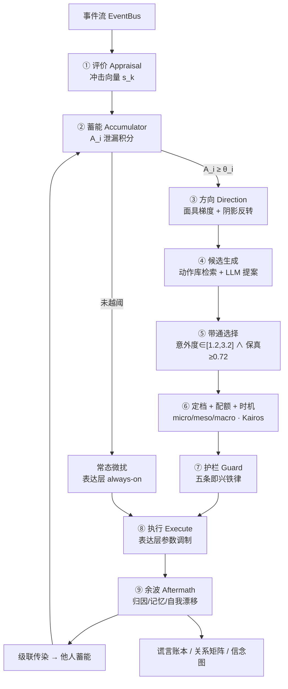

# 原始设定：人物即兴扰动系统（IPS v1.0）

> 来源：用户于 2026-11-26 提供的原始长文本，逐字归档；未删改。
> 定位：IMMS 的行为调制层，挂在 §9.2 效用函数与 §6 表演层之间；不新增真相，只新增人味。
> 用途：与 IMMS 融合可行性审计的唯一基线，见 docs/IPS_FUSION_AUDIT.md。

---

# 人物即兴扰动系统（Improvisational Perturbation System, IPS v1.0）

> **一句话定位**：即兴不是掷骰子，而是 **「长期压抑的真实人格，在某个恰好的瞬间，沿着面具的裂缝定向漏出来」**。
>
> **核心公式直觉**：`即兴 = 蓄能 × 触发 × 方向(真实−面具) × 幅度 × 时机 × 表达 × 余波`
>
> 本系统是 IMMS 的**行为调制层**，挂在 §9.2 效用函数与 §6 表演层之间，**不新增真相，只新增"人味"**。

---

## 目录

| 章节 | 内容 |
|---|---|
| [一](#一定位即兴--随机--失控) | 定位：即兴 ≠ 随机 ≠ 失控 |
| [二](#二总体架构九段流水线) | 总体架构：九段流水线 |
| [三](#三输入全量特征向量) | 输入：全量特征向量 |
| [四](#四冲动引擎蓄能触发双阈值) | 冲动引擎：蓄能—触发双阈值 |
| [五](#五方向引擎面具滑落--人格阴影) | 方向引擎：面具滑落 + 人格阴影 ★ |
| [六](#六候选生成与双目标带通选择) | 候选生成与双目标带通选择 ★ |
| [七](#七即兴动作库) | 即兴动作库（可直接建表） |
| [八](#八幅度定档配额与时机窗口) | 幅度定档、配额与时机窗口 |
| [九](#九表达层微扰常态always-on) | 表达层微扰（常态 always-on） |
| [十](#十执行护栏五条即兴铁律) | 执行护栏：五条即兴铁律 |
| [十一](#十一余波闭环后悔圆场加码) | 余波闭环：后悔/圆场/加码 ★ |
| [十二](#十二级联传染与阻尼) | 级联传染与阻尼 |
| [十三](#十三数据结构伪代码与-prompt) | 数据结构、伪代码与 Prompt |
| [十四](#十四参数总表与导演拨盘) | 参数总表与导演拨盘 |
| [十五](#十五评估指标与防退化) | 评估指标与防退化 |
| [十六](#十六完整数值走查) | 完整数值走查（国风示例） |
| [十七](#十七落地与扩展) | 落地与扩展 |

---

## 一、定位：即兴 ≠ 随机 ≠ 失控

| 行为类型 | 驱动 | 可预测性 | 是否可复盘 | 例子 |
|---|---|---|---|---|
| **常规行为** | 效用最大化 $U(a)$ | 高 | 是 | 有证据就指控 |
| **即兴行为** ★ | 蓄能越阈 + 人格定向泄露 | **低但事后可解释** | 是（必须） | 老实人突然掀桌 |
| **失控行为** | 随机数 / 幻觉 | 无 | 否 | AI 突然编造线索 |

> **判定标准（黄金准则）**：
> **观众事前想不到，事后一想"就该是他"。**
> 工程化表达：**意外度（surprisal）足够高，人格保真度（fidelity）不下降。**
> 这就是 §6 的**双目标带通滤波器**——本系统的选择器核心。

**三种"不好"的即兴，必须被系统拒绝**：

| 反模式 | 症状 | 拦截点 |
|---|---|---|
| 假即兴（噪声） | 与人格无关的怪异举动 | 保真度闸门 $F(a)\ge 0.72$ |
| 坏即兴（破坏） | 销毁唯一线索、编造真相 | 五条即兴铁律（§10） |
| 滥即兴（抽搐） | 每轮每人都在爆发 | 蓄能阈值 + 不应期 + 令牌配额 |

---

## 二、总体架构：九段流水线



**双通道设计（关键）**：

- **通道 A｜常态微扰**：永远开启，只作用于**表达层**（语气、停顿、口癖），零风险，让角色"活着"。
- **通道 B｜事件驱动显扰/剧扰**：阈值触发，作用于**行为层与关系层**，有风险，让剧情"炸开"。

> 只有通道 B 的系统 = 平时像机器人，偶尔发癫。
> 只有通道 A 的系统 = 有演技没剧情。
> **两者必须并存。**

---

## 三、输入：全量特征向量

即兴的输入是**人格全量快照**，而非单一属性。定义特征向量：

$$
\mathbf{x}_i(t)=\big[\underbrace{\mathbf{p}}_{\text{L1 人格}},\ \underbrace{\mathbf{v}}_{\text{价值观}},\ \underbrace{\mathbf{m}}_{\text{L2 面具}},\ \underbrace{\mathbf{R}_{i\to\cdot}}_{\text{L3 关系}},\ \underbrace{\mathbf{e}}_{\text{PAD}},\ \underbrace{\mathbf{z}}_{\text{状态}},\ \underbrace{\mathbf{g}}_{\text{目标}},\ \underbrace{\mathbf{c}}_{\text{局势}}\big]
$$

| 分组 | 字段 | 在即兴中的角色 |
|---|---|---|
| $\mathbf{p}$ 人格 | OCEAN 五维 | **N** → 阈值↓；**C** → 泄漏↑阈值↑；**A** → 攻击类动作权重↓；**E** → 外显类↑；**O** → 罕见动作↑ |
| $\mathbf{v}$ 价值观 | honesty / loyalty / ambition / justice / face(面子) / kinship | 动作合法性权重 + 余波策略 |
| $\mathbf{m}$ 面具 | mask{} 各维伪装值 | **面具梯度 $\mathbf{p}-\mathbf{m}$ = 即兴的主方向** |
| $\mathbf{R}$ 关系 | 11 维有向 × N 人 | 锁定**焦点对象** $j^*$；`grudge` 提供慢蓄能 |
| $\mathbf{e}$ 情绪 | valence / arousal / dominance | 强度放大 + 采样温度 + 表达参数 |
| $\mathbf{z}$ 状态 | stress / cognitive_load / intoxication / morale / exposure_risk | 阴影反转触发 + 失误率 |
| $\mathbf{g}$ 目标 | goals[] 权重 + secrets[] 暴露代价 | 硬闸门（不能自毁核心目标） |
| $\mathbf{c}$ 局势 | heat / round / silence / attention / polarization | 时机窗口 + 全局配额 |
| L0 元 | acting_skill / difficulty / improv_gain | 泄露自然度 + 运营拨盘 |
| 创伤 | trauma[] + shadow_coef $\zeta_f$ | **雷区放大 1.8×** + 决定哪一维会反转 |

> **抽取补充**：`shadow_coef ζ_f`（人格阴影系数）需在原书抽取阶段一并产出——
> **判据**：该维度上"平时表现"与"极端情境下表现"的落差。落差越大，$\zeta$ 越高。
> 例：尤二姐平时极顺从（A=.82），但在被逼绝境时会说出致命秘密 → $\zeta_A=0.95$。

---

## 四、冲动引擎：蓄能—触发双阈值

### 4.1 为什么需要蓄能器

突发事件（被扇耳光）会引发即兴，但**更高级的戏剧是"最后一根稻草"**：
一连串小屈辱积累 8 轮，在第 9 轮因为一句无关紧要的话彻底爆发。

**泄漏积分器（Leaky Accumulator）**：

$$
A_i(t{+}1)=\rho_i\,A_i(t)+\sum_{k\in E_t}s_k\cdot\chi_i(k)\cdot\kappa_{ij}\cdot\big(1+\gamma_g\,\mathrm{grudge}_{i\to j}\big)
$$

| 符号 | 含义 | 公式 / 默认 |
|---|---|---|
| $A_i$ | 冲动蓄能 | $[0,1.5]$，允许超阈溢出 |
| $\rho_i$ | 泄漏率（自控力） | $\rho_0\big(1-0.30C_i-0.20(1-N_i)\big)$，$\rho_0=0.90$ |
| $s_k$ | 事件基础冲击 | 见 §4.2 |
| $\chi_i(k)$ | 归因/创伤放大 | 故意 1.2 / 被迫 0.5；命中创伤 ×1.8 |
| $\kappa_{ij}$ | 关系放大 | $1+0.6\,intimacy$（越亲近越伤） |
| $\gamma_g$ | 旧怨加成 | 0.5（翻旧账的数学表达） |

> **人格差异自动涌现**：
> - 高 C 低 N（沉稳者）：$\rho\approx0.60$ → 泄漏快 → 极难爆发，但一旦爆发 $A$ 必然极高 → **强度极大**。
> - 低 C 高 N（敏感者）：$\rho\approx0.88$ → 泄漏慢 → 频繁小爆发 → **情绪化**。
>
> **同一个公式，两种截然不同的人物。这就是"全量特征驱动"的价值。**

### 4.2 事件冲击表 $s_k$（即兴专用，与关系更新表并列）

| 事件 | $s_k$ | 主要冲击维度 |
|---|---|---|
| 当众羞辱 / 揭短 | 0.32 | 面子、dominance |
| 谎言被当场戳穿 | 0.38 | 暴露风险、face |
| 被冤枉（无据指控） | 0.26 | justice |
| 亲近者背叛 | 0.45 | loyalty、intimacy |
| 秘密被点破一半 | 0.50 | exposure_risk |
| 被无视 / 打断（小事） | 0.06 | 累积用 |
| 被抢功 / 被替代 | 0.14 | ambition |
| 提及创伤关键词 | 0.28×1.8 | trauma |
| 他人当众示好（意外暖流） | 0.20 | **正向即兴源** |
| 目睹不公 | 0.18 | justice |
| 酒精上头 | +0.10/轮 | intoxication |
| 死讯 / 生命威胁 | 0.40 | fear、morale |

> **注意正向即兴**：即兴不全是失控发怒。**意外的善意会引发"突然的坦白/维护/落泪"**——这是角色弧光最动人的部分。冲击表必须双向。

### 4.3 触发判定与不应期

$$
\theta_i=\mathrm{clip}\Big(\theta_0\big(1+0.35C_i-0.30N_i\big)\cdot\Theta_{\text{refr}}(t),\ 0.30,\ 0.95\Big),\qquad \theta_0=0.60
$$

$$
\text{触发}\iff A_i(t)\ge\theta_i \quad\wedge\quad \text{令牌可用}\quad\wedge\quad K(t)>K_{\min}
$$

**即兴强度**：

$$
I_i=\mathrm{clip}_{[0,1]}\Big(\underbrace{\frac{A_i-\theta_i}{1-\theta_i}}_{\text{超阈深度}}\cdot 0.7+\underbrace{\max_k s_k}_{\text{峰值冲击}}\cdot 0.6+\underbrace{0.25\,\mathrm{arousal}_i}_{\text{情绪助燃}}\Big)
$$

**爆发后处理（宣泄 + 不应期）**：

$$
A_i\leftarrow A_i\cdot(1-\eta),\quad \eta=0.60;\qquad
\Theta_{\text{refr}}=1.4\ \text{持续}\ R=2\ \text{轮}
$$

> $\eta$ 是**宣泄系数**：爆发后确实"舒服了"，蓄能清空——但**关系损失已经造成，不可回收**。这制造了经典的"一时冲动，代价终生"。

---

## 五、方向引擎：面具滑落 + 人格阴影

**这是整个系统的灵魂。即兴必须有方向，不能是随机噪声。**

### 5.1 面具滑落定律（Mask-Slip Law）

$$
\boxed{\ \Delta\mathbf{v}^{\text{shown}}=\varepsilon\cdot\big(\mathbf{v}^{\text{canon}}-\mathbf{v}^{\text{mask}}\big)\ }
$$

- $\varepsilon$：本次即兴幅度（§8）。
- **含义**：即兴永远沿"**真实人格 − 面具人格**"的梯度方向泄露。
- 与 IMMS §6.2 的关系：$\sigma_{\text{leak}}$ 是**随机泄露**（无方向噪声），本式是**定向泄露**（有方向的真相浮现）。二者叠加 = 完整的"面具滑落"。

**戏剧学意义**：

| 角色 | canon | mask | 即兴方向 |
|---|---|---|---|
| 伪善的慈善家 | A=.25 | A=.85 | 突然刻薄、露出算计 |
| 假装冷酷的深情者 | like=.8 | like=0 | 突然维护、失控关心 |
| 顺从的隐忍者 | grudge=.7 | grudge=0 | 突然反击、说出秘密 |
| 假装勇敢的懦夫 | fear=.8 | fear=.1 | 突然逃跑、推卸 |

> **一个公式生成四类经典人物崩解**。而且**方向由原书决定，不由编剧硬写**——这就是"基于全量特征"的兑现。

### 5.2 人格阴影反转（Shadow Inversion / 自我损耗）

解释"老实人掀桌"：**极端压力下，被长期压抑的对立极性短暂接管。**

$$
\tilde{v}_f=v_f+\mathbb{1}\big[A_i>\theta_i\big]\cdot\zeta_f\cdot 2\big(0.5-v_f\big)\cdot\underbrace{\min\Big(1,\tfrac{A_i-\theta_i}{1-\theta_i}+\mathrm{stress}_i\Big)}_{\text{反转强度}\ \Omega}
$$

- $\zeta_f\in[0,1]$：该维阴影系数（原书抽取）。
- $v_f>0.5$ → 向下反转；$v_f<0.5$ → 向上反转。**总是朝对立面走。**
- **仅在本次即兴窗口（1–2 轮）生效**，之后回归基线。$\mathbf{v}^{\text{canon}}$ **本体不变**（人格守恒）。

**示例**：$\zeta_A=0.95,\ v_A=0.82,\ \Omega=0.85$
$$\tilde{v}_A=0.82+0.95\times2\times(0.5-0.82)\times0.85=0.82-0.517=\mathbf{0.30}$$
→ 顺从者在这一刻**攻击性超过王熙凤**。而且**完全可解释**：因为她压抑了 8 轮。

### 5.3 方向合成

$$
\mathbf{d}_i=\mathrm{norm}\Big(w_m(\mathbf{v}^{\text{canon}}-\mathbf{v}^{\text{mask}})+w_s\,\mathbf{shadow}(\tilde{\mathbf{v}}-\mathbf{v})+w_e\,\mathbf{e}_i+w_r\,\mathbf{R}_{i\to j^*}+w_g\,\mathbf{g}_i\Big)
$$

**焦点对象**（即兴冲谁去）：

$$
j^*=\arg\max_j\ \Big[\sum_k s_k\cdot\mathbb{1}[\text{src}(k)=j]\Big]\cdot\big(1+0.5\,\mathrm{grudge}_{i\to j}\big)
$$

默认权重：$w_m=0.40,\ w_s=0.25,\ w_e=0.15,\ w_r=0.15,\ w_g=0.05$。

> $\mathbf{d}_i$ 是**行为语义空间中的方向向量**，用于 §6 对候选动作做**方向对齐打分**。这保证"愤怒时不会突然讲冷笑话"。

---

## 六、候选生成与双目标带通选择

### 6.1 两个正交指标

**① 意外度（Surprisal）**——衡量"想不到"：

$$
s(a)=-\log P\big(a\mid \text{persona},\text{context}\big)\quad[\text{nats}]
$$

工程估计（三源融合，避免调大模型算 logprob）：

$$
s(a)\approx-\log\Big[\pi_{\text{lib}}(a)\cdot \mathrm{fit}_{\text{persona}}(a)\cdot \mathrm{freq}_{\text{session}}(a)\Big]
$$

- $\pi_{\text{lib}}$：动作库基础先验（"喝口茶"高频，"掀桌"低频）
- $\mathrm{fit}$：人格似然（高 A 者做攻击动作 → 概率低 → 意外度高）
- $\mathrm{freq}$：本局已出现频次（**重复的即兴不再意外**，自动抑制老套）

**② 保真度（Fidelity）**——衡量"就该是他"：

$$
F(a)=\lambda_1\cos\big(\mathrm{emb}(a),\mathrm{anchor}_i\big)+\lambda_2\,\mathrm{ValueFit}(a,\mathbf{v})+\lambda_3\,\mathrm{MotifFit}(a,\text{lexicon})
$$

### 6.2 带通接受域（核心闸门）

$$
\boxed{\ \mathrm{Accept}(a)\iff s(a)\in[1.2,\ 3.2]\ \wedge\ F(a)\ge0.72\ \wedge\ V(a)=0\ \wedge\ \mathrm{tier}(a)\le\mathrm{Quota}\ }
$$

```
意外度轴：  0 ────── 1.2 ═══════ 2.0 ═══════ 3.2 ────── ∞
           │ 无聊区  │      ★ 有效即兴带 ★      │  OOC区 │
           │ 常规行为│    "意外但合理"          │ 失控/幻觉│
```

- $s<1.2$：太常规 → 降级为**常态微扰**（§9），不占配额。
- $s>3.2$：太离谱 → 直接拒绝（这就是"老实人突然掏出枪"被拦下的地方）。
- **中心 $s^*=2.0$**：最佳戏剧意外度。

### 6.3 打分与采样

$$
\mathrm{Score}(a)=\underbrace{e^{-\frac{(s(a)-s^*)^2}{2\varsigma^2}}}_{\text{带通核},\ \varsigma=0.8}\cdot\underbrace{F(a)^{\alpha}}_{\alpha=2.0}\cdot\underbrace{\mathrm{Drama}(a)^{\beta}}_{\beta=1.2}\cdot\underbrace{\big\langle\hat{\mathbf{a}},\mathbf{d}_i\big\rangle_+^{\gamma}}_{\text{方向对齐},\ \gamma=1.5}
$$

$$
\mathrm{Drama}(a)=\mathbb{E}\big[|\Delta\mathbf{R}|\big]+\mathrm{InfoGain}(a)+\mathrm{GapFill}(t)
$$

$$
P(a)=\frac{\exp\big(\mathrm{Score}(a)/T_{\text{imp}}\big)}{\sum_{a'}\exp\big(\mathrm{Score}(a')/T_{\text{imp}}\big)},\qquad T_{\text{imp}}=0.35\big(1+0.8\,\mathrm{arousal}+0.5\,\mathrm{intoxication}\big)
$$

**兜底（重要）**：若候选集为空 → 从**安全即兴库**取一个低幅高表现力动作（凝视、放下茶盏、突然改称呼、长久沉默）。
> **沉默是最安全的即兴**。永远给系统一个"体面退场"的选项，避免为了即兴而即兴。

---

## 七、即兴动作库

> 可直接建表。`前置` 是硬门槛，`人格倾向` 是权重乘子，`档` 决定配额消耗，`可逆` 决定是否需 GM 令牌。

### 7.1 言语类（micro / meso）

| 动作 | 前置 | 人格倾向 | 档 | 副作用 | 可逆 |
|---|---|---|---|---|---|
| 突然改称呼（敬→平/蔑） | 关系变化 > 0.2 | 低 A、高 arousal | micro | 全场察觉关系异动 | ✓ |
| 口误说漏半个名字 | cognitive_load > .5 | 低 C | meso | 生成 `unverified_claim` | ✗ |
| 讲不合场合的冷笑话 | arousal > .6 | 高 E、低 A | micro | respect −.05，heat −.1 | ✓ |
| 突然引用诗句/典故 | 有 lexicon.motif | 高 O | meso | respect +.1，暗示身份 | ✓ |
| 反复追问同一细节 | suspicion > .6 | 高 C、高 N | meso | 对方 stress +.2 | ✓ |
| 当众自嘲 | morale < .4 | 高 N、低 dominance | meso | respect −.1，like +.1 | ✓ |
| 突然长时间沉默 | 任意 | 低 E | micro | 全场 attention +.2 | ✓ |
| 语无伦次 / 自我修正 | stress > .7 | 低 C | micro | 他人 suspicion +.1 | ✓ |
| 说漏秘密碎片 | exposure_risk > .6 | 低 acting_skill | **macro** | secret 部分曝光 | ✗ |

### 7.2 情绪—肢体类（micro / meso / macro）

| 动作 | 前置 | 人格倾向 | 档 | 副作用 | 可逆 |
|---|---|---|---|---|---|
| 手抖 / 茶盏磕响 | arousal > .5 | 高 N | micro | 泄露 σ_leak ×1.5 | ✓ |
| 突然落泪 | valence < −.5 | 高 N、高 A | meso | 他人 like +.15 / fear −.1 | ✓ |
| 冷笑三声 | dominance > .3 | 低 A | micro | 目标 grudge +.1 | ✓ |
| 摔杯 / 掀桌 | $A>\theta$、阴影反转 | $\zeta_A$ 高 | **macro** | 全场 arousal +.3，respect ±.2 | ✗ |
| 突然离场 | morale < .25 | 低 C、高 fear | **macro** | 失去 1 轮行动权 | ✗ |
| 大笑不止 | intoxication > .6 | 高 E | meso | 全场 suspicion +.1 | ✓ |
| 突然下跪 / 认亲 | debt > .6 或 kinship | 高 kinship | **macro** | commitment +.4 | ✗ |

### 7.3 关系类（meso / macro）

| 动作 | 前置 | 人格倾向 | 档 | 副作用 |
|---|---|---|---|---|
| 突然维护陌生人 | justice 高、目睹不公 | 高 justice | meso | 与被维护者 like +.3 |
| 当众背刺盟友 | Align 越过 $\theta_{on}$ | 高 ambition、低 loyalty | **macro** | 阵营反转，全场极化 +.2 |
| 向宿敌示好 | morale < .3 | 高 O | meso | 对方 suspicion −.15 |
| 拒绝昔日盟友求助 | grudge > .5 | 低 A | meso | commitment −.4 |
| 无端偏袒（泄露真情） | 真实 like > .7 且 mask < .2 | 低 acting_skill | meso | **面具梯度泄露**，他人可察 |

### 7.4 信息类（meso / macro，**最高风险，最严闸门**）

| 动作 | 前置 | 档 | 强制约束 |
|---|---|---|---|
| 临场编造不在场证明 | exposure_risk > .5 | meso | 立即写 LieLedger，**初始 heat = 0.4**（无准备） |
| 即兴坦白部分真相 | morale < .3 且令牌可用 | **macro** | 只可坦白 `beliefs` 中已有事实；不可逆 |
| 抛出半真半假试探 | suspicion > .5 | meso | 必须标注 `claimed_facts` 与真值分离 |
| 即兴指控（无据） | arousal > .7 | meso | 他人 respect −.1（无据指控有代价） |
| 临时伪造线索 | forgeable 且 AP ≥ 3 | **macro** | **不得替换唯一证据路径**（§10 R3） |

### 7.5 安全即兴库（兜底，永远可用）

`凝视不语` / `缓缓放下茶盏` / `指尖敲桌三下` / `改口"你"为"您"` / `望向窗外` / `重复对方最后三个字` / `忽然一笑随即收敛`

> 成本≈0，风险=0，戏剧收益中等。**建议占全部即兴的 40%**——克制才是高级。

---

## 八、幅度定档、配额与时机窗口

### 8.1 三档幅度

| 档 | $\varepsilon$ | 作用层 | 关系冲击 | 触发强度 | 配额 |
|---|---|---|---|---|---|
| **micro 微扰** | 0.10–0.30 | 表达层 | ≤ ±0.05 | $I<0.35$ | 无限（但不占 attention） |
| **meso 显扰** | 0.30–0.60 | 言语/关系 | ±0.10–0.25 | $0.35\le I<0.70$ | 每人每幕 ≤ 2 |
| **macro 剧扰** | 0.60–1.00 | 行为/阵营/秘密 | ±0.30–0.60 | $I\ge0.70$ | **每人每局 ≤ 2；全场每幕 ≤ 1** |

$$
\varepsilon=\mathrm{clip}\big(0.15+0.85\,I_i,\ 0.1,\ 1.0\big)\cdot\underbrace{(1-0.3\,\mathrm{acting\_skill}_i)}_{\text{演技好的人崩得少}}
$$

### 8.2 全局令牌池（防"全员发癫"）

```python
class ImprovBudget:
    macro_per_act   = 1      # 全场每幕仅 1 次剧扰 → 保证爆点稀缺
    meso_per_agent  = 2
    macro_per_agent = 2      # 整局
    cascade_depth   = 2      # 传染最多 2 跳
    refractory      = 2      # 爆发后 2 轮不应期
```

**令牌竞争**：同一轮多人越阈时，按 $\mathrm{Score}$ 排序，**只放最高者**，其余转入蓄能保留（$A$ 不清空）→ **下一轮优先爆发**。
> 副作用极妙：**没抢到令牌的人会更愤怒**（$A$ 继续累积），下一次强度更大。压抑—爆发的节奏自然形成。

### 8.3 时机窗口 Kairos

$$
K(t)=\mathrm{Attn}(t)\cdot\mathrm{Rel}(a,\text{topic}_t)\cdot\big(1+\mathrm{Gap}(t)\big)\cdot\mathrm{Insertable}(t)
$$

| 因子 | 计算 |
|---|---|
| $\mathrm{Attn}$ | 当前发言者被关注度（正在被质询者 = 1.0） |
| $\mathrm{Rel}$ | 即兴动作与当前话题的语义相关度 |
| $\mathrm{Gap}$ | $1-H(t)/H^*(t)$，**节奏缺口**（冷场时 GM 更愿意放行） |
| $\mathrm{Insertable}$ | 是否有可插入间隙（私聊/圆桌/质询允许，投票阶段禁止） |

**门槛**：micro $K>0.15$｜meso $K>0.40$｜macro $K>0.60$。

> **导演学落地**：同样一句话，在众人安静注视你时说出，与在七嘴八舌中说出，戏剧效果差 10 倍。**时机分数把这条经验变成了可计算量。**

---

## 九、表达层微扰（常态 always-on）

**不改内容，只改"怎么说"。零风险，让角色永远不像模板。**

### 9.1 状态 → 语言参数映射表

| 语言参数 | 基线 | 调制公式 | 效果 |
|---|---|---|---|
| 平均句长 $L$ | $L_0$（Canon 指纹） | $L_0(1-0.40\,\mathrm{arousal})$ | 激动 → 短句、断裂 |
| 断句/省略号密度 | $d_0$ | $d_0(1+1.2\,\mathrm{stress})$ | 慌乱 → "我……我不是……" |
| 感叹/反问密度 | $q_0$ | $q_0(1+0.9\,\mathrm{arousal}\cdot\mathbb{1}[v<0])$ | 愤怒 → 反问连击 |
| 自我修正次数 | 0 | $\lfloor 3\,\mathrm{cognitive\_load}\rfloor$ | 心虚 → 说错又改 |
| 敬语等级 | $\ell_0$ | $\ell_0-\lfloor 2\varepsilon\rfloor$ | **称呼降级=关系异动的信号** |
| 口癖密度 | $k_0$ | $k_0(1+0.6\,\mathrm{arousal})$ | 激动 → 口癖加重（人物更鲜明） |
| 方言/母语渗出 | 0 | $p=0.3\,\mathrm{intoxication}+0.2\,\mathrm{stress}$ | 失态 → 露出身世底细 |
| 语序倒装率 | 0 | $0.25\,\mathrm{arousal}$ | 情绪压倒语法 |
| 停顿标记 | 0 | $\lfloor 2\,\mathrm{stress}\rfloor$ | 供 TTS 与"演技"使用 |
| 词汇华丽度 | $w_0$ | $w_0(1-0.3\,\mathrm{load})$ | 认知负荷高 → 用词变糙 |

### 9.2 常态微扰触发

$$
p_{\text{micro}}=0.25+0.30\,\mathrm{arousal}+0.20\,\mathrm{intoxication}
$$

每轮每人独立判定；命中则从**微扰库**采样 1 项，叠加到语言参数上。

> **关键**：微扰**不进入事件日志的"行为"字段**，只进入 `delivery` 字段。
> 这样复盘时可以清晰区分"他做了什么"与"他怎么做的"，也便于统计与降噪。

---

## 十、执行护栏：五条即兴铁律

> 即兴可以破**面具**，绝不可以破**世界**。这是与 IMMS §10 三重护栏并列的第四层护栏。

| 编号 | 铁律 | 工程实现 |
|---|---|---|
| **IR1** | **即兴不创造事实** | 即兴产出一律标记 `unverified_claim`，**禁止写入 TruthGraph**；只能进他人 BeliefGraph（且 `is_true` 由 GM 判定） |
| **IR2** | **即兴不超知** | 坦白/编造只能操作 `beliefs ∪ secrets ∪ public`；编造内容必须标 `lie_id` |
| **IR3** | **即兴不破坏可解性** | 销毁/伪造前检查：若该线索是某关键结论的**唯一独立路径** → 降级为"损坏但可修复"或"伪造失败" |
| **IR4** | **即兴不违反剧本锁与核心目标** | `script_locks` 优先；不得自毁权重 > 0.8 的主线目标（除非 morale < 0.15 的"彻底崩盘"，需 GM 令牌） |
| **IR5** | **即兴不可无后效** | 每个 meso/macro 必须产生 ≥1 条 `aftermath` 记录与 ≥1 项他人状态变化，否则视为无效即兴并回滚 |

```python
def improv_guard(agent, act, world):
    if act.creates_new_truth_fact:            return downgrade(act, "claim_only")   # IR1
    if not knowledge_subset(act, agent):      return rewrite(act)                   # IR2
    if act.destroys_clue and is_unique_path(act.clue, world):
        return downgrade(act, "damaged_recoverable")                                # IR3
    if violates_lock(act, agent) or kills_core_goal(act, agent):
        return substitute_safe_improv(agent)                                        # IR4
    if act.tier >= MESO and not has_aftermath(act):
        return attach_aftermath(act)                                                # IR5
    return act
```

---

## 十一、余波闭环：后悔 / 圆场 / 加码

**即兴最容易被忽略、却最决定"像不像人"的一环：事后的自我反应。**

### 11.1 自我归因（Self-Appraisal）

即兴执行后，角色对自己刚才的行为做一次评价，产生**自我惊讶**：

$$
\mathrm{SelfSurprise}_i=s(a)\cdot\big(1-\mathrm{acting\_skill}_i\big)
$$

### 11.2 三种余波策略（softmax 选择）

$$
\begin{aligned}
z_{\text{regret}} &= 1.2N_i+0.8C_i+1.0\,\mathrm{honesty}-0.6\,\mathrm{arousal}\\
z_{\text{rationalize}} &= 1.0O_i+1.2\,\mathrm{acting\_skill}+0.6(1-N_i)\\
z_{\text{escalate}} &= 1.3\,\mathrm{exposure\_risk}+1.0(1-\mathrm{morale})+0.9\,\mathrm{arousal}-0.8\,\mathrm{loyalty}
\end{aligned}
$$

$$
P(\text{strategy})=\mathrm{softmax}\big([z_{\text{regret}},z_{\text{rationalize}},z_{\text{escalate}}]/0.5\big)
$$

| 策略 | 行为表现 | 数值后果 |
|---|---|---|
| **后悔 regret** | 下一轮道歉、找补、"我方才是失言了" | 目标 like +.10，自身 stress +.15，**但已泄露信息不可回收** |
| **圆场 rationalize** | 编织解释、把即兴纳入既有谎言 | 新增/追加 LieLedger，`heat += 0.25` |
| **加码 escalate** | 破罐破摔、"我说的就是真的，怎样？" | 关系继续恶化 ×1.4，`exposure_risk +.2`，**可能连锁触发第二次 macro** |

> **设计价值**：一次冲动 → 三种人物走向。高 N 者后悔纠缠，高 acting 者天衣无缝，绝望者一路走到黑。
> **同一触发，三种人生。这才是"多变量"。**

### 11.3 记忆烙印与自我概念漂移

**记忆重要性**（远高于普通事件）：

$$
\mathrm{imp}(m)=0.6+0.4\,I_i,\qquad \tau_m\leftarrow 3\tau_m
$$

并写入**情绪一致性标签** → 未来在相似情绪下极易被检索出来（**创伤复现机制**）。

**自我概念漂移（允许 canon 极缓慢演化，但硬上限）**：

$$
\Delta\,\mathrm{self\_concept}_f=\kappa\cdot\big(\tilde{v}_f-v_f\big)\cdot I_i,\qquad \kappa=0.05,\quad \big|\textstyle\sum_{\text{局}}\Delta\big|\le 0.08
$$

> 角色会开始想："原来我也是会掀桌的人。"
> **上限 0.08 是人格守恒的保险丝**：允许成长，禁止变身。跨本元游戏时这条尤其重要。

### 11.4 对他人的冲击（观察者结算）

即兴事件在他人处享受**意外放大**：

$$
\beta^{\text{obs}}_c(k)=\beta_c(k)\cdot\big(1+0.5\,s(a)/2.0\big)
$$

即：**越意外的事件，对他人的关系冲击越大**（符合心理学归因强度）。同时观察者 `arousal += 0.20` → 喂给 §12 级联。

---

## 十二、级联传染与阻尼

**一人掀桌，全场变色**——但必须防雪崩。

$$
P_{\text{cascade}}(j)=p_0\cdot\underbrace{\big(1-C_j\big)}_{\text{自控弱}}\cdot\underbrace{\mathrm{arousal}_j}_{\text{已激动}}\cdot\underbrace{\big(1+0.6\,intimacy_{j\to i}\big)}_{\text{关系近}}\cdot\underbrace{0.5^{\,d}}_{\text{深度阻尼}}
$$

$p_0=0.35$，$d$ = 传染跳数。

**三重阻尼（必须全部实现）**：

| 阻尼 | 规则 |
|---|---|
| 深度上限 | $d\le2$（A 引发 B，B 引发 C，C 不能再引发 D） |
| 档位递减 | 级联产生的即兴**强制降一档**（macro → meso → micro） |
| 全局配额 | 级联仍受 `macro_per_act = 1` 约束；超额者转入蓄能保留 |

> **效果**：一次爆发形成 2–3 人的连锁反应后自然平息，而不是全场同时发疯。
> **戏剧节奏 = 一个爆点 + 两圈涟漪 + 一段沉默。** 沉默由 §8.3 的 `Gap` 与 §9 微扰接管。

---

## 十三、数据结构、伪代码与 Prompt

### 13.1 核心数据结构

```json
// 冲动状态（每角色一份，随快照落库）
{
  "agent_id": "char_07",
  "accumulator": 0.88,
  "theta": 0.61,
  "refractory_until_round": 0,
  "last_burst_round": 0,
  "budget": {"macro_left": 2, "meso_left": 2},
  "shadow_coef": {"A": 0.95, "E": 0.30, "C": 0.15},
  "grudge_focus": "char_02"
}
```

```json
// 即兴行为（完整可复盘）
{
  "improv_id": "imp_011",
  "agent_id": "char_07",
  "round": 5,
  "tier": "macro",
  "action_key": "blurt_secret_fragment",
  "trigger": {
    "events": ["ev_088", "ev_091"],
    "accumulator_before": 0.88,
    "theta": 0.61,
    "intensity": 0.83,
    "focus_target": "char_02"
  },
  "direction": {
    "mask_gradient": {"A": -0.54, "grudge": 0.70},
    "shadow_active": {"A": {"from": 0.82, "to": 0.30, "omega": 0.85}},
    "vector": [0.21, -0.63, 0.44, ...]
  },
  "selection": {
    "surprisal": 3.02,
    "fidelity": 0.76,
    "drama": 0.81,
    "direction_align": 0.88,
    "score": 0.64,
    "candidates_rejected": [
      {"key": "weep_silently", "reason": "surprisal 0.4 < 1.2"},
      {"key": "draw_dagger",   "reason": "surprisal 4.6 > 3.2"}
    ]
  },
  "timing": {"kairos": 0.74, "attention": 0.95, "gap": 0.10},
  "epsilon": 0.71,
  "delivery": {
    "sentence_len": 6, "honorific_level": 0,
    "ellipsis_density": 0.35, "tremor": true, "dialect_leak": 0.2
  },
  "speech_act": {
    "act_type": "assert",
    "utterance": "账上的银子去了哪儿，你当我不知道？",
    "claimed_facts": ["f_044"],
    "is_unverified_claim": true,
    "inner_intent": "我忍不住了，我要她也不好过",
    "emotion_shown": "决绝", "emotion_real": "恐惧+后悔萌芽"
  },
  "guard": {"IR1": "pass_claim_only", "IR3": "n/a", "IR4": "pass"},
  "aftermath": {
    "strategy": "regret",
    "self_surprise": 2.4,
    "memory_importance": 0.93,
    "self_concept_delta": {"A": -0.026},
    "observers_delta": {
      "char_02": {"trust": -0.52, "grudge": 0.31, "arousal": 0.35},
      "char_05": {"suspicion_char_02": 0.35, "arousal": 0.28}
    },
    "cascade": [{"agent": "char_05", "tier": "meso", "depth": 1}]
  },
  "seed": "a7f3c9e21b"
}
```

### 13.2 主循环伪代码

```python
def improvisation_step(agent, events, world, t):
    # ① 评价 → 冲击
    shocks = [appraise_shock(agent, e) for e in events]      # s_k, χ, focus

    # ② 蓄能（泄漏积分）
    rho = 0.90 * (1 - 0.30*agent.C - 0.20*(1 - agent.N))
    agent.A = rho * agent.A + sum(s.total for s in shocks)

    # 常态微扰：无论是否爆发都要"活着"
    delivery = micro_perturb(agent)                          # §9

    # ③ 触发判定
    theta = agent.theta * (1.4 if t < agent.refractory_until else 1.0)
    if agent.A < theta:
        return None, delivery

    I = clip(0.7*(agent.A-theta)/(1-theta) + 0.6*max(s.base for s in shocks)
             + 0.25*agent.arousal, 0, 1)

    # ④ 方向：面具梯度 + 阴影反转
    shadow = shadow_invert(agent, I)                         # §5.2 临时人格
    d = normalize(0.40*(agent.canon - agent.mask)
                + 0.25*(shadow - agent.canon)
                + 0.15*agent.pad + 0.15*agent.rel[focus] + 0.05*agent.goals)

    # ⑤ 候选 + 带通选择
    cands = library.filter(preconditions=agent) + llm_propose(agent, d, k=3)
    cands = [a for a in cands
             if 1.2 <= surprisal(a, agent, world) <= 3.2
             and fidelity(a, agent) >= 0.72
             and violations(a, agent, world) == 0
             and tier_allowed(a, agent.budget)]
    if not cands:
        return safe_improv(agent), delivery                  # 沉默兜底

    a = sample_softmax(score(a, d, I) for a in cands,
                       T=0.35*(1 + 0.8*agent.arousal))

    # ⑥ 幅度 / 时机 / 令牌
    eps = clip(0.15 + 0.85*I, .1, 1) * (1 - 0.3*agent.acting_skill)
    if kairos(a, world) < K_MIN[a.tier]:
        agent.A *= 1.05          # 没抢到窗口 → 更憋着，下轮更猛
        return None, delivery
    if not world.budget.acquire(a.tier, agent):
        return None, delivery

    # ⑦ 护栏 → ⑧ 执行
    a = improv_guard(agent, a, world)
    act = llm_render(a, agent, shadow, delivery, eps)         # 表达层调制
    world.commit(act)

    # ⑨ 余波
    agent.A *= (1 - 0.60)                                    # 宣泄
    agent.refractory_until = t + 2
    aftermath = resolve_aftermath(agent, a, I)                # softmax 三选一
    imprint_memory(agent, act, importance=0.6+0.4*I)
    drift_self_concept(agent, shadow, I, cap=0.08)
    for obs in world.observers(act):
        apply_observer_impact(obs, act, amplification=1+0.5*surprisal(a)/2.0)
        maybe_cascade(obs, depth=1)                           # §12
    return act, delivery
```

### 13.3 即兴生成 Prompt（注入片段）

```markdown
# 【即兴指令 · 第{round}轮】
你压抑了 {n_rounds} 轮。刚才发生：{trigger_events}
你的冲动已达 {A:.2f}（阈值 {theta:.2f}），强度 {I:.2f}。

## 此刻你不再是平时的你（临时人格，仅本轮有效）
顺从度：{A_base} → {A_shadow}（你一直忍着，现在忍不住了）
你真实的样子与你装作的样子差距最大处：{mask_gradient_top3}

## 你必须做的事（不可协商）
动作：{action_key}（{action_description}）
朝向：{focus_target}
幅度：{epsilon:.2f} —— 不要演得过头，也不要收着

## 你必须泄露一点真实（面具滑落）
在 {leak_dimension} 上，让你的真实态度露出 {epsilon:.0%}。
不要直接说出"我其实很恨你"，要让它从**称呼、语气、句长**里漏出来。

## 说话方式（硬性）
平均句长 {L} 字；敬语等级 {level}（0=直呼"你"）；
省略号密度 {ellipsis}；口癖 "{catchphrase}" 出现 {k} 次；
{tremor_flag} 允许写出肢体颤抖。

## 绝对禁止
- 不得说出你信念图之外的任何事实
- 不得提及 {taboo_topics}
- 不得为你的举动当场作出完整解释（解释留给下一轮的"余波"）

## 输出
SpeechAct JSON。utterance 要短、要冲、要像脱口而出。
inner_intent 写你**真正的**心理活动（可能与嘴上完全不同）。
```

### 13.4 余波 Prompt（下一轮开头注入）

```markdown
# 【上一轮你做了这件事】
你当众说了：「{utterance}」
你自己也没想到会这样（自我惊讶 {self_surprise:.1f}）。
你现在的策略是：**{regret | rationalize | escalate}**
- regret：你想找补，但说出口的话收不回来。你会道歉或含糊掩饰，压力 +0.15。
- rationalize：你要把这句话编进你的说法里。新增谎言已记入账本，heat={heat}。
- escalate：你决定一条路走到黑。你会加倍强硬，关系继续恶化。
本轮你的发言必须体现这个策略，且**不得与上一轮矛盾**。
```

---

## 十四、参数总表与导演拨盘

### 14.1 即兴系统参数（默认值可直接抄）

| 参数 | 符号 | 默认 | 作用 |
|---|---|---|---|
| 基础泄漏率 | $\rho_0$ | 0.90 | 蓄能保持 |
| 基础阈值 | $\theta_0$ | 0.60 | 爆发难易 |
| 宣泄系数 | $\eta$ | 0.60 | 爆发后清空比例 |
| 不应期 | $R$ | 2 轮 | 防连发 |
| 不应期阈值倍数 | $\Theta_{\text{refr}}$ | 1.4 | 同上 |
| 意外度带通 | $[s_{lo},s_{hi}]$ | [1.2, 3.2] | 核心闸门 |
| 最佳意外度 | $s^*$ | 2.0 nats | 打分中心 |
| 带通宽度 | $\varsigma$ | 0.8 | 容忍度 |
| 保真门槛 | $\tau_F$ | 0.72 | 人格守恒 |
| 打分指数 | $\alpha,\beta,\gamma$ | 2.0 / 1.2 / 1.5 | 保真/戏剧/方向权重 |
| 即兴温度 | $T_{\text{imp}}$ | 0.35 基 | 采样随机性 |
| 方向权重 | $w_m,w_s,w_e,w_r,w_g$ | .40/.25/.15/.15/.05 | 方向合成 |
| 微扰概率 | $p_{\text{micro}}$ | 0.25 基 | 常态活性 |
| 级联基概率 | $p_0$ | 0.35 | 传染强度 |
| 级联深度 | $d_{\max}$ | 2 | 防雪崩 |
| 自我漂移率/上限 | $\kappa$ / cap | 0.05 / 0.08 | 人格保险丝 |
| 创伤放大 | — | 1.8× | 雷区 |
| 意外冲击放大 | — | $1+0.5s/2$ | 他人反应强度 |

### 14.2 导演拨盘（运营 5 旋钮，对外暴露）

| 拨盘 | 范围 | 影响 | 用途 |
|---|---|---|---|
| `improv_gain` 戏浓度 | 0.5–2.0 | 全局 $\theta_0$ 反向缩放 | 整局风格：写实 ↔ 浓烈 |
| `chaos` 混乱度 | 0–1 | $T_{\text{imp}}$、$p_0$ | 控制不可预测程度 |
| `shadow_sensitivity` 阴影敏感 | 0–1 | $\zeta$ 全局乘子 | 是否允许"老实人掀桌" |
| `leak_rate` 泄露率 | 0–1 | $\varepsilon$ 乘子 | 面具滑落速度 |
| `macro_quota` 爆点配额 | 0–3/幕 | 令牌池 | 高潮密度 |

**预设风格档位**：

| 风格 | gain | chaos | shadow | leak | quota | 观感 |
|---|---|---|---|---|---|---|
| 本格冷推理 | 0.6 | 0.2 | 0.3 | 0.4 | 1/局 | 克制，靠逻辑 |
| 社会派人性剧 | 1.2 | 0.4 | 0.8 | 0.7 | 1/幕 | 压抑与爆发 |
| 国风宅斗 | 1.4 | 0.3 | 0.9 | 0.9 | 1/幕 | 绵里藏针，突然见血 |
| 闹剧本 | 1.8 | 0.8 | 0.7 | 0.8 | 2/幕 | 密集笑点 |
| 情感本 | 1.3 | 0.5 | 0.6 | 1.0 | 1/幕 | 真心话大冒险 |

---

## 十五、评估指标与防退化

### 15.1 核心指标（自对弈可自动统计）

| 指标 | 定义 | 目标区间 |
|---|---|---|
| **有效即兴率** ★ | 引发他人 $\|\Delta R\|>0.15$ 或信念改变的即兴占比 | **30%–60%** |
| 即兴密度 | meso+macro 次数 / (人·轮) | 0.15–0.35 |
| 意外度均值 | $\overline{s(a)}$ | 1.8–2.3 nats |
| 保真度均值 | $\overline{F(a)}$ | ≥ 0.80 |
| OOC 拒绝率 | 被 $F$ 或带通上界拦截的候选占比 | 10%–25%（太低说明候选太保守） |
| 兜底占比 | 安全即兴库占比 | 30%–45%（克制指标） |
| 级联深度分布 | d=1 占 70%，d=2 占 30%，d≥3 = 0 | 硬约束 |
| 余波覆盖率 | 有 aftermath 的 meso+macro 占比 | **100%** |
| 人格漂移量 | 局末 $\|\Delta\text{self\_concept}\|$ | ≤ 0.08 |
| 可解性保持 | 即兴后 `verify_solvability` 仍通过 | **100%** |

> **"有效即兴率"是最重要的单一指标**：
> < 30% = 系统在自嗨（角色发癫但没人 care，纯噪声）；
> > 60% = 系统在轰炸（每次都是核弹，观众疲劳，剧情失控）。

### 15.2 防退化清单

| 风险 | 症状 | 对策 |
|---|---|---|
| 即兴抽搐 | 每轮都有人爆发 | 阈值 + 不应期 + 令牌池 + 密度监控 |
| 全场发疯 | 级联雪崩 | 深度 ≤2 + 档位递减 + 全局配额 |
| 假意外 | 动作怪异但无人格根据 | 保真闸门 + 方向对齐 $\gamma$ |
| 老套化 | 反复摔杯 | $\mathrm{freq}_{\text{session}}$ 抑制 + 库内冷却 |
| 破坏案件 | 即兴销毁关键证据 | IR3 唯一路径保护 |
| 幻觉造事实 | 即兴"说出"不存在的线索 | IR1 claim-only |
| 人格变身 | 局末判若两人 | 阴影仅临时 + 漂移 cap 0.08 |
| 只怒不暖 | 全是攻击性即兴 | 冲击表**必须含正向事件** + 正向动作库配额 ≥ 25% |
| 时机尴尬 | 投票时突然抒情 | Kairos 门槛 + `Insertable` 阶段白名单 |
| 不可复现 | 复盘对不上 | `seed = hash(session, agent, round, event_id)` 全程确定性随机 |

---

## 十六、完整数值走查

**承接上一版设定**：`char_07`（尤二姐原型）
`A=.82, N=.71, C=.45, O=.40, E=.35`；`ζ_A=.95`；`mask.grudge=0`，`canon.grudge=0.62`；`acting_skill=.35`。
对 `char_02`（王熙凤原型）：`intimacy=.45, grudge=.55`。

### R2–R4：慢蓄能（最后一根稻草的铺设）

| 轮 | 事件 | $s_k$ | $\chi$ | $\kappa$ | 旧怨加成 | 增量 | $A$（$\rho=.90(1-.135-.058)=.726$） |
|---|---|---|---|---|---|---|---|
| R2 | 被当众打断（小事） | .06 | 1.2 | 1.27 | 1.275 | .117 | 0.117 |
| R3 | 被暗示"你不懂账" | .14 | 1.2 | 1.27 | 1.275 | .255 | 0.340 |
| R4 | 提及创伤关键词 | .28 | **1.8** | 1.27 | 1.275 | .818 | **1.064** |

> R4 已越阈（$\theta=0.60(1+.158-.213)=.567$），但 **Kairos = 0.28 < 0.60**（当时七嘴八舌，无人注意她）→ **令牌未放行**，$A\leftarrow1.064\times1.05=1.117$。
> **她憋回去了。系统记录：`suppressed_burst`。** 这是最珍贵的一条日志。

### R5：爆发

| 步骤 | 计算 | 结果 |
|---|---|---|
| 蓄能 | $.726\times1.117+.32\times1.2\times1.27\times1.275$ | $A=0.811+0.622=\mathbf{1.433}$ |
| 阈值 | $\theta=.567$（无不应期） | 越阈 ✓ |
| 强度 | $0.7\frac{1.433-.567}{.433}+0.6(.32)+0.25(.62)$ | clip → $I=\mathbf{1.00}$ |
| **阴影反转** | $\Omega=\min(1,2.0+.45)=1$；$\tilde{A}=.82+.95\cdot2(.5-.82)\cdot1$ | $A: .82\to\mathbf{0.21}$ |
| 面具梯度 | `grudge: .62−0 = +.62`，`A: .82−.85 = −.03` | 主方向：**怨怼浮现** |
| 焦点 | $\arg\max$ 冲击 × 旧怨 | `char_02` |
| 幅度 | $(0.15+0.85\times1.0)(1-0.3\times.35)$ | $\varepsilon=\mathbf{0.895}$ |
| 时机 | 正被质询，$\mathrm{Attn}=.95$，话题相关 .82，可插入 1.0 | $K=\mathbf{0.78}>0.60$ ✓ |
| 令牌 | 本幕 macro 未用 | 放行 ✓ |

**候选打分**：

| 候选 | $s(a)$ | $F(a)$ | 方向对齐 | 判定 |
|---|---|---|---|---|
| 垂泪不语 | 0.4 | .95 | .30 | ✗ 意外度不足 → 降为微扰 |
| 冷笑反问 | 1.8 | .82 | .65 | ✓ Score .41 |
| **说漏秘密碎片** | **3.02** | **.76** | **.88** | **✓ Score .64 ← 中選** |
| 拔刀相向 | 4.6 | .21 | .70 | ✗ 意外度超界 + 保真不足 |
| 掀桌离场 | 2.4 | .78 | .72 | ✓ Score .52 |

**表达层调制**：句长 $18\to18(1-.4\times.62)=13.5\to$ 实写 6 字短句；敬语等级 $2-\lfloor2\times.895\rfloor=0$ → **"二奶奶"变成"你"**；省略号密度 .35；颤抖 = true。

**输出**：
> 「账上的银子去了哪儿，你当我不知道？」
> `inner_intent`：我忍不住了，我要她也不好过。
> `emotion_real`：恐惧 + 后悔萌芽。

**护栏**：IR1 → `f_044` 标记 `unverified_claim`，**不写入 TruthGraph**；IR4 → 未触碰剧本锁 ✓。

### R5 余波与级联

| 项 | 计算 | 结果 |
|---|---|---|
| 宣泄 | $A\leftarrow1.433\times0.40$ | 0.573（低于阈值，暂时平静） |
| 不应期 | 至 R7，$\theta\times1.4=.794$ | 防连发 |
| 余波策略 | $z_{regret}=1.2(.71)+.8(.45)+1.0(.8)-.6(.62)=1.44$；$z_{rat}=0.4+1.2(.35)+.6(.29)=0.99$；$z_{esc}=1.3(.4)+1.0(.6)+.9(.62)-.8(.5)=0.64$ | softmax → **regret 55%** / rat 27% / esc 18% → **后悔** |
| 记忆烙印 | $0.6+0.4(1.0)=1.0$，$\tau\times3$ | 永久高位记忆 |
| 自我漂移 | $0.05(.21-.82)(1.0)$ | $\Delta A=-0.031$（累计上限 .08 内） |
| 02 反应 | $\beta_{trust}=-.45\times(1+.5\times3.02/2)=-.79$，×κ×ν | trust: .12 → **−0.52** |
| 05 反应 | 目击秘密碎片，$\log LR=+1.5$，$\omega=.8$ | suspicion(02): .41 → **.76** |
| 级联 | $P(.05)=.35(1-.5)(.28)(1+.6\times.3)\times.5=0.029$… 但 05 自身 $A$ 已达 .58 → 独立越阈 | **meso 即兴：趁乱伪造手帕**（d=1，降档） |
| 可解性 | 手帕非唯一路径 | `verify_solvability` ✓ |

### R6：后悔的代价

`char_07` 走 regret：「我……我方才是气话，二奶奶莫怪。」
→ 02 的 `like +.10`，但 **trust 不回补**（非对称原则 $\lambda^-_{trust}$）；
→ 05 的 `suspicion(02)=.76` **不可撤销**——**说出口的话收不回来**。
→ 07 自身 `stress +.15`，`morale −.1`，为下一次更大的崩溃埋下伏笔。

> **全程零硬编码**。没有任何一行脚本写着"尤二姐会在第 5 轮反击"。
> 它由 **4 个小事件的积分 + 1 个时机窗口 + 1 个阴影系数 + 1 次带通采样** 自然涌现，
> 且**每一步都能在复盘里指着数字说："就是这里，她忍不住了。"**

---

## 十七、落地与扩展

### 17.1 与 IMMS 的挂载关系（最小侵入）

```
IMMS §9 Agent 循环
  ├── 1 感知
  ├── 2 评价 ──────────► IPS ① 冲击评价（复用同一个 appraisal）
  ├── 3 记忆检索
  ├── 4 意图生成
  ├── 5 效用排序 U(a)
  │      └── ★ IPS 在此插入：若越阈 → 用 IPS 选择器覆盖 argmax U(a)
  ├── 6 LLM 生成 ──────► IPS ⑧ 表达层参数注入 delivery
  └── 7 护栏 ──────────► IPS ⑦ 第四层护栏（IR1–IR5）
                          IPS ⑨ 余波 → 写回 L3 / LieLedger / Memory
```

> **只需改动 3 处**：评价函数复用、效用排序处插入覆盖分支、生成时注入 delivery。
> **MVP 可先只做 §9 表达层微扰 + §4 蓄能器 + 安全即兴库**（约 300 行代码），立刻能让角色"活"起来；再逐步接入方向引擎与带通选择器。

### 17.2 分期交付

| 阶段 | 内容 | 工期 |
|---|---|---|
| **P0 活人感** | 蓄能器 + 表达层微扰 + 安全即兴库 | 1 周 |
| **P1 会爆发** | 阈值触发 + 三档幅度 + 令牌配额 + IR1–IR5 | 2 周 |
| **P2 有方向** | 面具梯度 + 阴影反转 + 带通选择器 | 2 周 |
| **P3 有后果** | 余波三策略 + 记忆烙印 + 自我漂移 + 级联 | 2 周 |
| **P4 可调可评** | 导演拨盘 + 10 项指标看板 + 自对弈调参 | 1 周 |

### 17.3 扩展方向（按价值排序）

1. **玩家同权即兴**：真人玩家可提交"即兴意图"（我想突然跪下），走**同一套闸门与余波结算**。系统不限制玩家，而是**给玩家的冲动赋予机制后果**——这是人机混编最优雅的接口。
2. **点火机制（Provocation）**：玩家可用言语主动抬高他人 $A_i$（戳创伤、揭短），把"嘴炮"变成**可量化的战术行为**。高 N 角色成为可被引爆的"炸弹"，社交博弈深度陡增。
3. **即兴回放剪辑**：从事件日志自动抽取 `tier=macro` 及其 ±2 轮上下文，生成"名场面"短视频脚本（含内心独白字幕）——天然的传播素材。
4. **阴影系数自动学习**：用自对弈数据反推 $\zeta_f$——若某角色在何种压力下的哪种反转最常被观众评为"神来之笔"，就强化该维阴影。**数据飞轮**。
5. **国风人格库**：从《红楼梦》《水浒》《史记》抽取 `OCEAN + ζ + trauma + lexicon`，形成可复用的"古典人格资产库"。**尤二姐的 $\zeta_A=0.95$、林黛玉的 $\zeta_{N}$、李逵的低 $\theta_0$**——这些不是编剧设定，是**从原著行为证据里算出来的**。这才是"真实属性提取"最大的红利。
6. **跨本创伤继承**：`self_concept` 漂移与高重要性记忆跨剧本保留（上限 0.08/局，多局累积上限 0.20），角色会"记得上一次你是怎么对他的"→ 赛季化长期关系。

---

### 需要你拍板的三件事

| 选项 | A | B | 影响 |
|---|---|---|---|
| **即兴强度默认档** | 本格冷推理（克制） | 社会派/宅斗（浓烈） | 决定 $\theta_0$、quota、$\zeta$ 初值 |
| **是否开放玩家点火** | 开放（社交博弈深） | 关闭（纯 AI 演绎） | 决定是否需 Provocation 接口与防滥用 |
| **阴影反转是否启用** | 启用（有"老实人掀桌"） | 关闭（人格绝对稳定） | 决定 P2 优先级与 OOC 风险敞口 |

告诉我选择，我可以直接把 **P0+P1 的可运行代码**给你：`Accumulator` + `micro_perturb` + `ImprovBudget` + `improv_guard` + 一个 6 人本的即兴动作库 YAML，跑一局就能看到"角色活起来"的效果。
