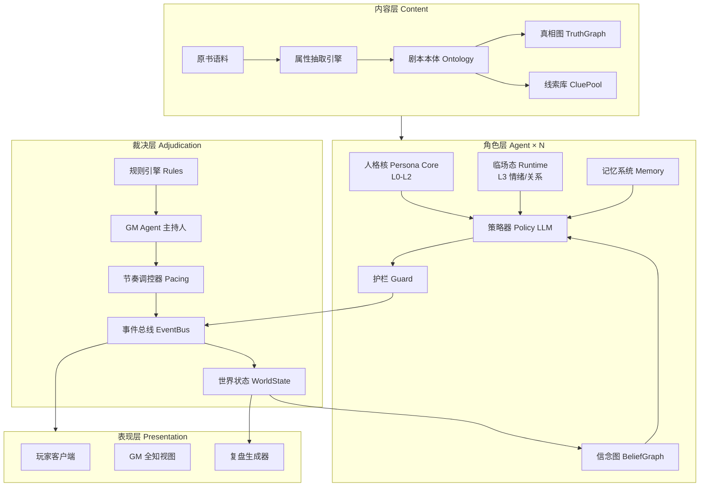
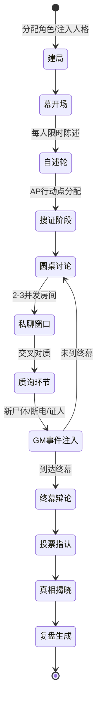

# 原始设定：智能剧本杀系统体系设定（IMMS v1.0）

> 来源：用户于 2026-11-26 提供的原始长文本，逐字归档；未删改。
> 用途：实现与缺口审计的唯一基线，见 docs/GAP_AUDIT.md。

---

# 智能剧本杀系统体系设定（Intelligent Murder-Mystery System, IMMS v1.0）

> **一句话定位**：以「**三层人格 + 有向关系场 + 信念图 + 事件溯源**」为内核，让每个 AI 角色既是"原书里的人"，又是"剧本里的人"，更是"这一局里被你我改变的人"。
>
> **设计信条**：人格可分层、态度可计算、信息可隔离、行为可解释、全局可回放。

---

## 目录

| 章节 | 内容 | 关键产出 |
|---|---|---|
| [一](#一设计目标与五条铁律) | 设计目标与五条铁律 | 约束边界 |
| [二](#二总体架构) | 总体架构 | 模块图 / 数据流 |
| [三](#三人格系统五层模型核心) | 人格系统五层模型 | 属性 Schema |
| [四](#四关系场与情绪动力学) | 关系场与情绪动力学 | 更新公式 |
| [五](#五认知层信念图与怀疑度) | 认知层：信念图与怀疑度 | 贝叶斯推理 |
| [六](#六表演层说谎与泄露) | 表演层：说谎与泄露 | 谎言账本 |
| [七](#七世界状态与剧本本体) | 世界状态与剧本本体 | 真相图 / 线索模型 |
| [八](#八回合结构与流程状态机) | 回合结构与状态机 | 节奏控制 |
| [九](#九agent-决策循环) | Agent 决策循环 | 效用函数 / 记忆 |
| [十](#十gm-裁决与三重护栏) | GM 裁决与三重护栏 | 反 OOC / 反泄底 |
| [十一](#十一从原书到可玩剧本自动生成) | 原书 → 剧本生成 | 可解性校验 |
| [十二](#十二变量总表) | 变量总表（多变量体系） | 60+ 可调参数 |
| [十三](#十三数据模型接口与-prompt) | 数据模型 / 接口 / Prompt | 可落地代码 |
| [十四](#十四评分复盘与防退化) | 评分、复盘与防退化 | 平衡性指标 |
| [十五](#十五实施路线与扩展) | 实施路线与扩展 | MVP → V2 |

---

## 一、设计目标与五条铁律

### 1.1 目标

1. **多变量的涌现性**：同一剧本、同一角色，因交互序列不同而走向不同结局（关系、阵营、证词、凶手存活率均可变）。
2. **人格的稳定性**：变量再多，林黛玉不会突然变成李逵。**变量自由，人格守恒**。
3. **信息的不对称性**：剧本杀的本质是"每个人手里都只有世界的一块碎片"。
4. **过程的可解释性**：任何一句指控、任何一次倒戈，都能回溯到"第几轮、哪条证据、哪个情绪事件"。
5. **内容的可生产性**：从一本小说自动产出可玩、可解、平衡的剧本。

### 1.2 五条铁律（硬约束，写进 Guard 而非 Prompt）

| 编号 | 铁律 | 工程实现 |
|---|---|---|
| R1 | **不可超知**：角色只能说出其信念图中持有的事实 | 输出前做 `fact_id ∈ Knowledge(i)` 校验 |
| R2 | **不可破角**：行为需通过人格一致性阈值 | 人格锚向量余弦相似度 ≥ 0.72 |
| R3 | **不可自相矛盾**：已出口的谎言必须持续维护 | LieLedger 一致性检查 |
| R4 | **不可跳过剧本锁**：关键情节必须触发 | Plot Lock 状态机强制 |
| R5 | **不可篡改真相**：GM 是唯一真相写入方 | 世界状态单一写入口 + 事件溯源 |

---

## 二、总体架构



**核心数据流（一次发言的完整生命周期）**：

```
事件发生 → 感知过滤(可见性) → 评价Appraisal → 更新(情绪/关系/信念)
        → 意图生成 → 效用排序 → LLM生成台词 → 三重护栏 → 落库 → 广播
```

> **关键分离**：**"想的"与"说的"必须分两个字段存储**。这是整个系统能支撑"伪装、试探、反串"的工程基础。

---

## 三、人格系统：五层模型（核心）

你提出的三层是骨架，我补两层让它闭环：**L0 元属性**（谁在演）与 **L4 表演层**（别人看到什么）。

```
L0 元属性 Meta      ── 操作者风格（真人玩家 / AI 难度档位）
      ↓ 调制
L1 真实属性 Canon   ── 原书提取，客观、恒定、默认隐藏
      ↓ 覆盖/伪装
L2 赋予属性 Assigned── 剧本给的公开身份、任务、初始关系、禁忌
      ↓ 运行时演化
L3 临场属性 Emergent── 好感/信任/怀疑/恐惧…（有向、非对称、可衰减）
      ↓ 策略投影
L4 表演层 Performed ── 对外可见的人格 = f(L1,L2,L3,策略,噪声)
```

### 3.1 L1 真实属性（Canon / 原书提取）

| 属性组 | 字段 | 说明 | 示例（王熙凤原型） |
|---|---|---|---|
| 身份 | `origin_name, lineage, social_rank` | 客观出身 | 金陵王家女，贾府琏二奶奶 |
| 生理 | `age, health, physique, marks` | 可成为证据 | 体弱、有心疾、右手烫疤 |
| 能力 | `skill_set{skill:level}` | 决定行动可行性 | 账目 9 / 权术 9 / 武艺 1 |
| 心理基线 | `OCEAN{O,C,E,A,N}` | 大五人格，0–1 | O .62 C .78 E .85 A .28 N .66 |
| 价值观 | `values{loyalty,justice,ambition,...}` | 效用权重来源 | ambition .9 / loyalty .3 |
| 创伤 | `trauma[]` | 情绪触发器 | 被夺权 → 愤怒阈值 −40% |
| 秘密 | `secrets[{fact_id, exposure_cost}]` | 核心动机源 | 挪用公款、害死尤二姐 |
| 语言指纹 | `lexicon, syntax, taboo_words, rhythm` | 保真度关键 | 歇后语密度高、爱用反问 |
| 关系史 | `history_relations[]` | 初始关系先验 | 与贾琏：亲密度高/信任低 |

> **抽取要点**：`OCEAN` 与 `values` 不要靠 LLM 一句"你觉得她是什么性格"直接给分，而应**先抽取行为证据句 → 再逐维打分 → 保留证据链**，这样后期可做一致性审计（见 §11.1）。

### 3.2 L2 赋予属性（Assigned / 剧本赋予）

| 字段 | 含义 | 是否对玩家公开 |
|---|---|---|
| `public_identity` | 剧本中的公开身份（可能与 Canon 不同） | 公开 |
| `mask{}` | 面具属性：对外声称的人格数值 | 公开表现 |
| `assigned_goals[]` | 主线/支线/隐藏任务，带权重与截止轮次 | 仅自己 |
| `initial_relations{}` | 剧本钦定的初始关系（覆盖 Canon 先验） | 部分 |
| `script_locks[]` | 必须说 / 禁止说 / 必须触发的桥段 | 仅自己+GM |
| `alibi_template` | 不在场证明模板（凶手用） | 仅自己 |
| `arc{}` | 角色弧光：期望的转变路径（如"傲慢→崩溃"） | 仅 GM |
| `faction_init` | 初始阵营 | 阵营内可见 |

**戏剧张力公式**（用于 GM 判断"这个角色什么时候该被逼到墙角"）：

$$
\mathrm{Tension}_i=\sum_{f\in F}\omega_f\cdot\big|v^{\text{canon}}_f-v^{\text{mask}}_f\big|\cdot \mathrm{Exposure}_f(t)
$$

- $v^{\text{canon}}$：真实值；$v^{\text{mask}}$：伪装值；$\mathrm{Exposure}_f\in[0,1]$：该属性被证据逼近的程度。
- $\mathrm{Tension}$ 越高 → 该角色**泄露噪声越大、决策温度越高**（见 §6.2），戏剧高潮自然涌现。

### 3.3 L3 临场属性（Emergent / 交互生成）

**分三簇，全部有向（i→j），全部非对称**：

| 簇 | 变量 | 范围 | 语义 |
|---|---|---|---|
| **情感簇** | `like` 好感 | [-1,1] | 喜欢/厌恶 |
| | `trust` 信任 | [-1,1] | 相信其诚实 |
| | `respect` 敬重 | [0,1] | 认可其能力 |
| | `intimacy` 亲密 | [0,1] | 心理距离 |
| **对抗簇** | `suspicion` 怀疑 | [0,1] | 认为其涉案 |
| | `fear` 畏惧 | [0,1] | 感到威胁 |
| | `envy` 嫉妒 | [0,1] | 相对剥夺感 |
| | `grudge` 怨恨 | [0,1] | 累积敌意（慢衰减） |
| **义务簇** | `debt` 亏欠 | [-1,1] | 正=我欠他 |
| | `dominance` 支配 | [-1,1] | 正=我压制他 |
| | `commitment` 盟约 | [0,1] | 结盟强度 |

**自身状态（非有向）**：

| 变量 | 范围 | 影响 |
|---|---|---|
| `valence / arousal / dominance`（PAD） | [-1,1]/[0,1]/[0,1] | 情绪三维，驱动语气与冲动 |
| `stress` 压力 | [0,1] | ↑ 泄露率、↑ 决策失误 |
| `cognitive_load` 认知负荷 | [0,1] | ↑ 逻辑漏洞率 |
| `intoxication` 醉意/药效 | [0,1] | ↑ 失言、↓ 记忆精度 |
| `morale` 士气 | [0,1] | ↓ 触发投降/坦白 |
| `exposure_risk` 暴露风险自评 | [0,1] | 驱动说谎与灭口 |

### 3.4 L0 元属性 & L4 表演层

- **L0**：`operator_type`(human/ai)、`difficulty`(1–5)、`acting_skill`、`lying_skill`、`play_style`(激进/稳健/搅局/沉默)、`meta_bias`（真人玩家的场外习惯）。AI 角色的 `acting_skill` 直接决定**伪装的自然度**。
- **L4**：对外可见的人格投影。**其他角色的感知只能读取 L4，永远读不到 L1/L3 真值**——这是"看走眼""识人不明"得以发生的机制。

### 3.5 属性统一数据结构（每个属性都是"五元组+"）

```json
{
  "key": "trust",
  "value": 0.35,
  "layer": "L3",
  "visibility": "self",              // public | faction | self | gm | truth
  "confidence": 0.7,                  // 持有者对该值的确信度
  "evidence": ["ev_014", "ev_027"],   // 证据链，支撑复盘
  "volatility": 0.25,                 // 易变性，影响更新步长
  "decay": {"lambda": 0.92, "baseline": 0.0, "tau_rounds": 8},
  "updated_at_round": 4,
  "locked": false                     // 剧本锁定时不可变
}
```

> **设计价值**：`evidence` 让"你为什么怀疑我"可被追问；`confidence` 让角色会说"我不太确定，但……"；`volatility` 让"多疑的人"和"钝感的人"用同一套公式却表现迥异。

---

## 四、关系场与情绪动力学

### 4.1 关系更新的统一公式

对任意关系维度 $c\in\{like, trust, respect, \dots\}$，在第 $t$ 轮事件集 $E_t$ 作用下：

$$
R^{c}_{i\to j}(t{+}1)=\mathrm{clip}_{[c_{\min},c_{\max}]}\Big(
b_c+\lambda_c\big(R^{c}_{i\to j}(t)-b_c\big)
+\sum_{k\in E_t}\beta_c(k)\cdot\eta_i(k)\cdot\kappa_{ij}(k)\cdot\nu_i
\Big)
$$

| 符号 | 含义 | 取值建议 |
|---|---|---|
| $b_c$ | 该维度的**回归基线**（由 Canon 人格决定） | 多疑者 $b_{trust}=-0.2$ |
| $\lambda_c$ | 衰减系数（向基线回归） | 好感 .92 / 怨恨 .98（慢忘） |
| $\beta_c(k)$ | 事件 $k$ 对维度 $c$ 的影响系数 | 见下表 |
| $\eta_i(k)$ | **归因折扣**：是否认为对方"出于故意" | [0,1.5] |
| $\kappa_{ij}$ | **关系放大**：越亲密，伤害/恩惠越放大 | $1+0.6\cdot intimacy$ |
| $\nu_i$ | 个体敏感度 $=0.5+N_i$（神经质） | [0.5,1.5] |

### 4.2 事件影响矩阵 $\beta$（节选，可配置）

| 事件 $k$ | like | trust | respect | suspicion | grudge | debt |
|---|---|---|---|---|---|---|
| 公开为我辩护 | +.18 | +.22 | +.08 | −.10 | −.05 | +.20 |
| 私下分享关键线索 | +.12 | +.25 | +.05 | −.08 | 0 | +.15 |
| 公开指控我（无据） | −.20 | −.25 | −.05 | +.05 | +.22 | −.10 |
| 指控我且证据成立 | −.10 | −.15 | +.10 | 0 | +.10 | 0 |
| 谎言被当场戳穿 | −.25 | **−.45** | −.20 | +.30 | +.15 | 0 |
| 被我抓到说谎 | −.15 | −.40 | −.10 | +.35 | +.05 | 0 |
| 替我隐瞒 | +.25 | +.30 | 0 | −.05 | 0 | +.35 |
| 落井下石 | −.35 | −.30 | −.15 | +.10 | +.40 | −.20 |
| 救我于危难 | +.40 | +.35 | +.20 | −.15 | −.20 | +.50 |
| 抢我功劳 | −.22 | −.18 | +.05 | +.05 | +.25 | −.15 |

> **非对称性原则（关键）**：信任的**负向增益约为正向的 2–3 倍**（$\beta^-_{trust}\approx 2.5\beta^+_{trust}$），且 $\lambda^-_{trust}>\lambda^+_{trust}$（跌得快、回得慢）。这一条让"背刺"具备真实的戏剧重量。

### 4.3 情绪 PAD 更新与衰减

$$
\mathbf{e}_i(t{+}1)=e^{-\Delta t/\tau_e}\,\mathbf{e}_i(t)+\sum_k \mathbf{A}_i(k)\cdot \mathbb{1}[\text{trigger}_k]
$$

- $\tau_e$：情绪半衰期（愤怒 ~2 轮，悲伤 ~6 轮，恐惧 ~4 轮）。
- **创伤触发器**：若事件命中 `trauma[]`，则 $\mathbf{A}$ 放大 1.8 倍且 $\tau_e$ 延长——**这就是"雷区"机制**。
- 离散情绪由 PAD 区域映射：`高唤醒+负效价+高支配 → 愤怒`；`高唤醒+负效价+低支配 → 恐惧`。

### 4.4 阵营漂移（带滞回，防抖动）

$$
\mathrm{Align}_{i\to F}=\underbrace{w_1\overline{R}_{i\to F}}_{\text{群体关系}}+\underbrace{w_2\,\mathrm{GoalFit}}_{\text{目标契合}}+\underbrace{w_3\,\mathrm{Safety}}_{\text{生存收益}}-\underbrace{w_4\,\mathrm{BetrayCost}}_{\text{背叛代价}}
$$

- 入盟阈值 $\theta_{on}=0.70$，脱盟阈值 $\theta_{off}=0.50$（**滞回区间**避免反复横跳）。
- 背叛需通过人格闸门：`loyalty` 高者 $w_4$ 极大 → 只有被逼到 `morale<0.2` 才可能倒戈。
- 阵营变更产生 `faction_shift` 事件，GM 可选择是否公开（公开=剧爆点）。

---

## 五、认知层：信念图与怀疑度

### 5.1 每个角色持有一份"世界副本"

```json
{
  "holder": "char_03",
  "fact_id": "f_017",
  "proposition": "案发时char_05在书房",
  "belief": 0.62,            // 主观置信度，可为错误
  "is_true": false,          // 仅GM可见
  "source": "testimony_char_05_r2",
  "source_trust": 0.4,
  "acquired_round": 2,
  "corroborations": ["clue_09"],
  "contradictions": ["clue_12"]
}
```

> **信念 ≠ 真相**。允许角色坚信错误的事，并据此行动——这是"误判""冤案""被误导"的来源，也是剧本杀最好玩的部分。

### 5.2 怀疑度：对数几率（log-odds）加性更新

设 $H_j$ = "j 是凶手"，对每条证据 $e$：

$$
\ell_{i\to j}(t)=\ell_0^{(i)}+\sum_{e\in \mathcal{E}_i(t)}\omega_i(e)\cdot\log\frac{P(e\mid H_j)}{P(e\mid \neg H_j)}
,\qquad
S_{i\to j}=\sigma\big(\ell_{i\to j}\big)=\frac{1}{1+e^{-\ell}}
$$

- $\ell_0^{(i)}$：先验偏见（由 Canon 的多疑度、初始关系决定）。
- $\omega_i(e)=\underbrace{\mathrm{cred}(src)}_{\text{来源可信}}\times\underbrace{\mathrm{strength}(e)}_{\text{证据强度}}\times\underbrace{(1-\mathrm{bias}_i)}_{\text{确认偏误}}$
- **伪证建模**：伪造线索的**真实**似然比 < 1（指向无辜者），但角色**误以为** > 1 → 二者分离存储，复盘时可展示"你被这条假线索骗了"。

**证据似然比配置示例**：

| 证据类型 | $\log LR$ | 说明 |
|---|---|---|
| 指纹/物证直接匹配 | +2.2 | 强 |
| 目击证词（来源信任>0.6） | +1.2 | 中强 |
| 时间线矛盾 | +1.5 | 强 |
| 动机存在 | +0.5 | 弱（人人有动机） |
| 神色慌张 | +0.3 | 极弱，易误判 |
| 有效不在场证明 | −2.5 | 强反证 |
| 他人担保（信任高） | −0.8 | 中弱 |

### 5.3 独立怀疑 vs 归一化指认

**严谨性要点**：$S_{i\to j}$ 是各自独立的怀疑度（可以都高）；投票时需要**归一化的指认分布**：

$$
P_i(\text{culprit}=j)=\frac{\exp(\ell_{i\to j}/T_v)}{\sum_{j'\in \mathcal{S}}\exp(\ell_{i\to j'}/T_v)}
$$

$T_v$ 为投票温度：`stress` 高 → $T_v$ 高 → 乱投；`C`（尽责性）高 → $T_v$ 低 → 集中投最强嫌疑。

### 5.4 矛盾检测（推理引擎的"啊哈时刻"）

对信念图做约束检查，发现冲突时生成 `contradiction_event`：

```python
def detect_contradiction(beliefs):
    conflicts = []
    for (a, b) in pairs(beliefs):
        if mutex(a.prop, b.prop) and a.belief > .5 and b.belief > .5:
            # 冲突强度 = 双方置信度 × 证据强度
            s = min(a.belief, b.belief) * strength(a, b)
            if s > 0.35:
                conflicts.append(Contradiction(a, b, s))
    return sorted(conflicts, key=lambda c: -c.strength)
```

触发后：角色 `arousal += 0.3`，`suspicion(相关方) += 0.2`，并**优先在下一轮抛出该矛盾**（AI 会"抓住把柄"）。

---

## 六、表演层：说谎与泄露

### 6.1 真实态度 vs 表现态度

$$
R^{\text{show}}_{i\to j}=\mathrm{clip}\Big(R^{\text{true}}_{i\to j}+\Delta^{\text{mask}}_{ij}+\epsilon\Big),\qquad
\epsilon\sim\mathcal{N}\big(0,\sigma_{\text{leak}}^2\big)
$$

$$
\sigma_{\text{leak}}=\sigma_0\cdot\big(1+\gamma_1\,\mathrm{arousal}_i\big)\cdot\big(1+\gamma_2\,\mathrm{stress}_i\big)\cdot\big(1-\mathrm{acting\_skill}_i\big)
$$

> **涌现效果**：一个心里厌恶你但表面结盟的角色，在**被激怒的那一轮**会不自觉地泄露真实态度（$\epsilon$ 变大），敏锐的对手（`O` 高、`respect` 高）能捕捉到。这就是"塑料同盟"的自然崩解。

### 6.2 说谎决策

$$
\mathrm{LieGain}=\underbrace{V_{\text{protect}}}_{\text{保护秘密价值}}+\underbrace{V_{\text{frame}}}_{\text{栽赃收益}}-\underbrace{P_{\text{exposed}}\cdot C_{\text{exposed}}}_{\text{暴露期望损失}}-\underbrace{\mu_i\cdot \mathrm{HonestyCost}}_{\text{道德成本}}
$$

- $P_{\text{exposed}}$ 由"在场者掌握的反证数量 + 自身 `cognitive_load`"估计。
- $\mu_i$ 来自 Canon 的 `values.honesty`——**正直的人说谎要付出心理代价，且更容易泄露**。
- 只有 $\mathrm{LieGain}>0$ 才说谎；否则说真话或**沉默/转移**（第三选项，很重要）。

### 6.3 谎言账本（LieLedger）——防自相矛盾的工程核心

```json
{
  "lie_id": "lie_003",
  "speaker": "char_05",
  "round_created": 2,
  "audience": ["char_01","char_03"],
  "claimed_facts": [
    {"prop": "我在22:00于花园", "true_value": false}
  ],
  "dependencies": ["lie_001"],       // 谎言链：必须一起维护
  "supporting_props": ["伪造的手帕"],
  "contradicted_by": [],
  "heat": 0.3,                        // 被质疑热度，>0.8 触发"圆谎或崩盘"
  "strategy": "maintain"              // maintain | patch | abandon | confess
}
```

**每轮生成台词前**，Guard 强制检索该角色所有 `heat>0.3` 的谎言，注入 Prompt：
> "你在第2轮对 A、C 说过你在花园。本轮不得与此冲突；若被追问，可选择：加固/打补丁/弃车保帅/坦白。"

**heat 更新**：$\text{heat}(t{+}1)=0.85\,\text{heat}(t)+0.4\cdot n_{\text{challenge}}+0.6\cdot n_{\text{contradiction}}$

### 6.4 言语行为结构化输出（Speech Act）

```json
{
  "act_type": "accuse",     // assert|ask|deny|accuse|deflect|ally|threaten|emote|confess
  "utterance": "二奶奶，那晚您说您在算账，可账房的灯，戌时就熄了。",
  "target": "char_02",
  "claimed_facts": ["f_031"],
  "inner_intent": "试探其不在场证明，同时向三爷示好",
  "true_belief_delta": {"suspicion_char_02": +0.15},
  "lie_id": null,
  "visibility": "public",
  "emotion_shown": "冷峻",
  "emotion_real": "紧张"
}
```

> `utterance` 给别人看，`inner_intent / emotion_real` 只进日志与复盘。**这一分离是系统"智能感"的最大来源。**

---

## 七、世界状态与剧本本体

### 7.1 剧本本体（Ontology）

```
Script
├── World: 时代/地点/封闭性/规则(超自然? 本格?)
├── TruthGraph: 真相事实三元组 (s, p, o, t, visibility)
├── Timeline: 真实时间线（分钟级）
├── Characters[]: L1+L2 人格卡
├── CluePool[]: 线索
├── CaseTemplate: 案件诡计类型
├── PlotLocks[]: 必经桥段
├── Endings[]: 结局条件与文本
└── SolvabilityProof: 可解性证明（生成时产出）
```

### 7.2 线索模型

```json
{
  "clue_id": "clue_12",
  "type": "physical",            // physical|testimony|document|behavioral
  "content": "账房烛台已燃尽，蜡油凝固约两时辰",
  "truth_value": true,
  "log_lr": {"char_02": +1.5, "char_05": -0.3},   // 对各嫌疑人的证据力
  "location": "账房",
  "discover": {"ap_cost": 2, "skill_req": {"观察": 3}, "base_prob": 0.7},
  "visibility": "finder",        // finder|public|faction
  "consumable": false,
  "forgeable": true,
  "forge_cost": 3,
  "decay_rounds": 6,             // 6轮后失效（雨水冲刷等）
  "chain": ["clue_09", "clue_15"] // 组合后才产生完整推论
}
```

**线索三性设计准则**：

| 准则 | 要求 |
|---|---|
| **指向性** | 每条线索必须携带非零 `log_lr`，否则是噪声（噪声占比 ≤ 20%） |
| **冗余性** | 每个关键结论至少 **2 条独立证据路径**（防单点卡死） |
| **可伪性** | 至少 30% 线索可被伪造/篡改，制造博弈空间 |

### 7.3 双轨时间线

- `Timeline_True`：客观发生（仅 GM）。
- `Timeline_Narrated[i]`：每个角色声称的版本。
- **推理 = 求两条时间线的差集与冲突集**。系统自动为每个角色计算 `alibi_gap`（不在场证明的空洞），空洞越大 `exposure_risk` 越高。

---

## 八、回合结构与流程状态机



### 8.1 资源与节奏变量

| 变量 | 说明 | 默认 |
|---|---|---|
| `AP` 行动点 | 每轮搜证/私聊/伪造/技能消耗 | 4/轮 |
| `speech_budget` | 单次发言字数/秒数上限 | 120字 |
| `challenge_token` | 质询次数（稀缺→需抉择） | 2/局 |
| `private_slot` | 私聊窗口数 | 2/幕 |
| `heat_curve` | 全场热度目标曲线 | 见下 |
| `pacing_gain` | GM 节奏调控增益 | 自适应 |

**热度曲线（GM 调控目标）**：

$$
H^{*}(t)=H_{\max}\cdot\Big(\frac{t}{T}\Big)^{1.6}
$$

实际热度 $H(t)=\alpha\cdot n_{\text{accuse}}+\beta\cdot n_{\text{contradiction}}+\gamma\cdot \overline{\mathrm{arousal}}$。

GM 调控：
$$
\text{if } H(t)<H^{*}(t)-\delta:\ \text{注入事件/释放线索};\quad
\text{if } H(t)>H^{*}(t)+\delta:\ \text{插入休整/私聊/幽默NPC}
$$

### 8.2 GM 事件注入库（多变量的外部扰动源）

| 事件 | 触发条件 | 影响变量 |
|---|---|---|
| 第二具尸体 | 进度 < 40% 且 t > T/2 | 全体 `fear+0.3`、`stress+0.25` |
| 停电/封锁 | 热度过低 | 搜证 AP −2、`arousal+0.2` |
| NPC 送来信件 | 关键结论缺证据 | 释放 clue，`belief` 更新 |
| 匿名举报 | 某角色 `exposure_risk` 高 | 该角色 `stress+0.4` |
| 旧情复燃 | 某对 `intimacy>0.7` | `commitment+0.3`，可能倒戈 |
| 酒后失言 | `intoxication>0.6` | 强制泄露一条 secret |
| 天气/时辰 | 定时 | 线索 decay 加速 |

---

## 九、Agent 决策循环

### 9.1 六步循环

```python
def agent_turn(agent, world, round_t):
    # 1 感知：只读取可见事件（可见性过滤）
    events = world.visible_events(agent.id, round_t)

    # 2 评价：事件 → 归因 → 情绪/关系/信念更新
    for ev in events:
        appraisal = appraise(agent, ev)          # 意图判定 η、是否命中创伤
        update_emotion(agent, appraisal)         # §4.3
        update_relations(agent, ev, appraisal)   # §4.1
        update_beliefs(agent, ev)                # §5.2

    # 3 记忆检索
    ctx = agent.memory.retrieve(query=events, k=12)   # §9.3

    # 4 意图生成：目标栈 + 当前局势 → 候选意图
    intents = propose_intents(agent, world)      # 试探/结盟/指控/自保/搅局/坦白

    # 5 效用排序 + LLM 具身化
    a_star = argmax_softmax(U(agent, intents))   # §9.2
    act = llm_generate(persona_card(agent), ctx, a_star, lie_ledger(agent))

    # 6 三重护栏 → 落库 → 广播
    act = guard(agent, act, world)               # §10
    world.commit(act)
    agent.memory.write(act, emotion=agent.emotion)
```

### 9.2 行为效用函数（人格 → 行为的桥梁）

$$
U(a)=w_p\,\mathrm{Fit}(a,\mathrm{Persona})+w_g\,\mathrm{Gain}(a,\mathrm{Goal})+w_e\,\mathrm{Impulse}(a,\mathbf{e})+w_s\,\mathrm{Social}(a,R)-w_r\,\mathrm{Risk}(a)-w_c\,\mathrm{Cost}(a)
$$

$$
P(a)=\frac{\exp\big(U(a)/T\big)}{\sum_{a'}\exp\big(U(a')/T\big)},\qquad T=T_0\big(1+\gamma\,\mathrm{arousal}+\gamma'\,\mathrm{intoxication}\big)
$$

- $\mathrm{Fit}$：行为与 OCEAN/价值观的契合度（**人格守恒项**）。
- $\mathrm{Impulse}$：情绪冲动项，`arousal` 高时权重上升 → 理性让位于情绪。
- $\mathrm{Social}$：$\sum_j R_{i\to j}\cdot \text{impact}(a,j)$ —— **临场属性在此正式接管行为**。
- $T$：温度，激动/醉酒 → 决策更随机、更"真人"。

### 9.3 记忆系统（四层）

| 层 | 内容 | 生命周期 |
|---|---|---|
| 工作记忆 | 当前轮上下文 | 1 轮 |
| 情节记忆 | 事件 + **情绪标记** + 关系快照 | 全局，带衰减 |
| 语义记忆 | 剧本知识、规则、人物常识 | 永久 |
| 反思记忆 | 每幕自动总结（"三爷一直在替二奶奶说话，他们可能有私"） | 永久，高权重 |

**检索评分**：

$$
\mathrm{score}(m)=\alpha\,e^{-\Delta t/\tau_m}+\beta\,\mathrm{imp}(m)+\gamma\,\cos(\mathbf{q},\mathbf{m})+\delta\,\mathrm{emo\_congruence}(m,\mathbf{e}_t)
$$

> `emo_congruence`：**心境一致性记忆**——愤怒时更容易想起对方的恶行。这是让 AI 显得"有情绪偏见"的关键，也是"翻旧账"行为的来源。

**反思触发**：当 $\sum \mathrm{imp}$ 累积超阈值或每幕结束，生成 3 条高层洞察写回记忆，权重 $\beta$ 加倍。

---

## 十、GM 裁决与三重护栏

### 10.1 三重护栏（输出后置校验，硬拦截）

```python
def guard(agent, act, world):
    # G1 知识护栏：不可超知
    for f in act.claimed_facts:
        if f not in agent.beliefs and f not in PUBLIC_FACTS:
            act = rewrite(act, remove=f, reason="knowledge_leak")

    # G2 人格护栏：不可破角
    if cos(embed(act), agent.persona_anchor) < 0.72:
        act = llm_regenerate(act, hint="回归人设：{persona_summary}")

    # G3 剧本护栏：不可自相矛盾 / 不可跳过锁
    if conflicts(act, agent.lie_ledger):
        act = patch_or_escalate(act)      # 圆谎 或 主动崩盘（戏剧性选择）
    if violates_taboo(act, agent.script_locks):
        act = block(act)

    # G4 反注入：玩家诱导泄底
    if detect_prompt_injection(act, world):
        act = deflect(act)              # 角色化地拒绝："这我可说不明白。"
    return act
```

### 10.2 GM Agent 的职责边界

| 职责 | 由谁执行 | 说明 |
|---|---|---|
| 真相写入、线索发放 | **规则引擎**（确定性） | 绝不由 LLM 决定 |
| 数值结算（关系/怀疑） | **公式引擎** | LLM 只做"事件分类与归因" |
| 叙事润色、氛围描写 | GM LLM | 温度可高 |
| 节奏调控、事件注入 | 混合（阈值触发 + LLM 选择） | |
| 玩家提问裁决 | GM LLM + 规则兜底 | |
| 复盘生成 | 事件日志 → LLM | 有日志约束，不会瞎编 |

> **黄金分工**：**数值归公式，语言归模型，真相归引擎。** LLM 负责"怎么说"和"这是什么性质的事件"，不负责"扣多少分"。这能同时保证可控性与表现力。

### 10.3 防冷场与扶弱

- 检测 `silence_rounds[i] > 2` → GM 点名提问 / 给该角色一条独家线索。
- 检测某角色被围攻（`n_accuse_target > 3`）且非凶手 → 注入救援线索，防冤案固化。
- 检测僵局（连续 2 轮无新信念）→ 强制触发 `contradiction_event` 或 NPC 证言。

---

## 十一、从原书到可玩剧本：自动生成

### 11.1 抽取流水线


**属性抽取的证据化 Prompt（关键）**：

```
【任务】从下文抽取人物 {name} 的人格维度。
【要求】
1. 每个维度先给出 2-3 条原文证据句（含章节定位），再给 0-1 分值。
2. 无证据支撑的维度标记为 null，禁止臆测。
3. 输出 JSON：{"维度":{"score":0.x,"evidence":[{"quote":"...","chapter":n}]}}
【原文】{text}
```

### 11.2 案件模板库

| 模板 | 核心诡计 | 关键变量 |
|---|---|---|
| 封闭山庄 | 空间封闭 + 时间差 | 人数、房间图、钥匙链 |
| 时间诡计 | 钟表/时辰错位 | `Timeline_gap` |
| 身份替换 | 双胞胎/易容/借尸 | `identity_mask` |
| 叙述性诡计 | 玩家自身记忆被篡改 | `belief.is_true=false` 批量注入 |
| 共犯结构 | 多人分工，互相不知情 | `faction` 隐式划分 |
| 无人生还 | 凶手在被害人中 | 动态死亡序列 |
| 罗生门 | 每人证词都真但片面 | 视角可见性差异 |
| 情感局 | 无凶手，考验关系与选择 | 关系矩阵主导结局 |

### 11.3 可解性校验（必须通过的硬门槛）

$$
\forall\, c\in \mathrm{KeyConclusions}:\quad \big|\mathrm{IndependentPaths}(c)\big|\ge 2
$$

```python
def verify_solvability(script):
    checks = {
        "唯一解": count_solutions(truth_graph, clue_pool) == 1,
        "证据冗余": all(len(paths(c)) >= 2 for c in key_conclusions),
        "无矛盾": not has_contradiction(truth_graph),
        "凶手可达": exists_path(clues, culprit),
        "无辜可洗": all(exists_alibi_path(innocent) for innocent in innocents),
        "锁可触发": all(reachable(lock) for lock in plot_locks),
        "信息闭合": all(needed_fact_covered(c) for c in key_conclusions),
    }
    return all(checks.values()), checks
```

**平衡性仿真**：用 5 档 AI 自对弈 200 局，要求：

| 指标 | 目标区间 |
|---|---|
| 凶手胜率 | 45%–55% |
| 平均破案轮次 | 0.6T–0.85T |
| 冤案率（错投无辜） | ≤ 25% |
| 关键线索发现率 | ≥ 70% |
| 冷场轮占比 | ≤ 10% |

---

## 十二、变量总表（多变量体系速查）

> 这是"多变量"的落地清单：**层级 / 范围 / 来源 / 触发 / 衰减 / 可见性**六要素齐全，可直接建表。

### 12.1 恒定层（L1 Canon）

| 变量 | 范围 | 来源 | 可变 | 可见性 |
|---|---|---|---|---|
| OCEAN 五维 | [0,1]×5 | 原书抽取 | ✗ | self/gm |
| values 价值观 | [0,1]×6 | 原书抽取 | ✗ | self/gm |
| skill_set | 0–10 | 原书+剧本 | 弱 | 部分公开 |
| secrets[] | 列表 | 原书+剧本 | 揭示后变 | self→public |
| trauma[] | 列表 | 原书 | ✗ | self/gm |
| lexicon 语言指纹 | 结构化 | 原书 | ✗ | 表现可见 |

### 12.2 剧本层（L2 Assigned）

| 变量 | 范围 | 更新触发 | 可见性 |
|---|---|---|---|
| public_identity | 枚举 | 剧情揭示 | public |
| mask{} | [0,1] | 策略调整 | 表现可见 |
| goals[] + weight | [0,1] | 完成/失败 | self |
| script_locks[] | 布尔集 | 触发即锁定 | self/gm |
| arc_progress | [0,1] | 关键事件 | gm |
| faction_init | 枚举 | 漂移时改变 | faction |

### 12.3 临场层（L3 Emergent，有向）

| 变量 | 范围 | λ 衰减 | 主要触发 |
|---|---|---|---|
| like | [-1,1] | .92 | 帮助/冒犯/幽默 |
| trust | [-1,1] | .95 | 兑现/说谎被抓 |
| respect | [0,1] | .97 | 精彩推理/示弱 |
| intimacy | [0,1] | .98 | 私聊/共谋/袒露 |
| suspicion | [0,1] | .99 | 证据/矛盾 |
| fear | [0,1] | .88 | 威胁/死亡 |
| envy | [0,1] | .96 | 他人获赞 |
| grudge | [0,1] | .985 | 背叛/羞辱 |
| debt | [-1,1] | .97 | 受恩/施恩 |
| dominance | [-1,1] | .93 | 压制/屈服 |
| commitment | [0,1] | .94 | 结盟/毁约 |

### 12.4 状态层（自身）

| 变量 | 范围 | 衰减/半衰期 | 影响 |
|---|---|---|---|
| valence | [-1,1] | τ=3 轮 | 语气正负 |
| arousal | [0,1] | τ=1.5 轮 | 温度 T、泄露 σ |
| dominance(PAD) | [0,1] | τ=2 轮 | 攻击性 |
| stress | [0,1] | τ=4 轮 | 失误率、坦白倾向 |
| cognitive_load | [0,1] | 即时 | 逻辑漏洞 |
| intoxication | [0,1] | τ=3 轮 | 失言 |
| morale | [0,1] | 慢 | 投降阈值 |
| exposure_risk | [0,1] | 实时计算 | 说谎/灭口决策 |

### 12.5 局势层（全局）

| 变量 | 说明 |
|---|---|
| `round_t / T_total` | 进度 |
| `heat H(t)` | 全场热度 |
| `info_entropy` | 全场信念熵，越低越接近共识 |
| `consensus_culprit` | 归一化指认众数 |
| `clue_revealed_ratio` | 线索释放率 |
| `faction_polarization` | 阵营极化度 |
| `alive_count` | 存活人数 |
| `pacing_gain` | GM 调控强度 |

### 12.6 元层（L0）

`difficulty(1-5)`、`acting_skill[0,1]`、`lying_skill[0,1]`、`play_style`、`temperature_base`、`verbosity`、`meta_bias`。

> **调参建议**：先固定 L1/L2，只放开 L3 的 11 个有向变量 + 8 个状态变量，共 **19 个自由度**即可产生极其丰富的分支；局势层用于 GM 自动调控，不暴露给玩家。

---

## 十三、数据模型、接口与 Prompt

### 13.1 核心表结构（事件溯源）

```sql
-- 事件日志：唯一真相来源，可完整回放
CREATE TABLE events (
  event_id   BIGSERIAL PRIMARY KEY,
  session_id UUID,
  round      INT,
  seq        BIGINT,           -- 全局单调序号，解决私聊并发竞态
  actor      VARCHAR(32),
  act_type   VARCHAR(24),
  payload    JSONB,            -- SpeechAct 完整结构
  visibility JSONB,            -- 可见角色列表
  created_at TIMESTAMPTZ
);

-- 状态快照：每轮末物化，避免重放全量
CREATE TABLE state_snapshots (
  session_id UUID, round INT, agent_id VARCHAR(32),
  relations JSONB,   -- L3 有向矩阵行
  emotion   JSONB,   -- PAD + 状态
  beliefs   JSONB,   -- 信念图
  PRIMARY KEY (session_id, round, agent_id)
);

CREATE TABLE persona_cards (agent_id VARCHAR(32), layer VARCHAR(4), data JSONB);
CREATE TABLE clues (clue_id VARCHAR(32), session_id UUID, data JSONB, state VARCHAR(16));
CREATE TABLE lie_ledger (lie_id VARCHAR(32), agent_id VARCHAR(32), data JSONB, heat REAL);
CREATE TABLE truth_graph (fact_id VARCHAR(32), s VARCHAR, p VARCHAR, o VARCHAR, t INT);
```

### 13.2 主要 API

| 方法 | 路径 | 说明 |
|---|---|---|
| POST | `/sessions` | 建局（剧本 ID、玩家数、AI 填充、难度） |
| GET | `/sessions/{id}/me` | 我的角色卡（**按可见性裁剪**） |
| POST | `/sessions/{id}/act` | 提交言语行为 / 行动 |
| POST | `/sessions/{id}/search` | 消耗 AP 搜证 |
| POST | `/sessions/{id}/private` | 开私聊房间 |
| GET | `/sessions/{id}/events?since=seq` | 增量拉取（可见性过滤） |
| POST | `/sessions/{id}/vote` | 投票 |
| GET | `/sessions/{id}/replay` | 全知回放（结束后开放） |
| POST | `/scripts/generate` | 原书 → 剧本 |
| POST | `/scripts/{id}/verify` | 可解性 + 平衡性报告 |

### 13.3 Persona Prompt 模板（分块注入，抗漂移）

```markdown
# 你是谁（L1 真实·仅你自知）
姓名：{canon.name}｜出身：{canon.lineage}
性格基线：O{O} C{C} E{E} A{A} N{N}；价值观：{values}
你的秘密：{secrets}（暴露代价：{cost}）
你的雷区：{trauma}（被触碰时你会失控）
说话方式：{lexicon}；口癖：{catchphrase}；禁用词：{taboo}

# 你在本局的身份（L2 赋予）
公开身份：{public_identity}
对外人设（必须维持）：{mask}
你的任务：{goals}（主线权重 {w}）
剧本锁：必须说「{must_say}」；绝不可提及「{taboo_topics}」

# 此刻的你（L3 临场·第{round}轮）
情绪：{discrete_emotion}（唤醒{arousal}，压力{stress}）
你对他人的真实态度：{relations_true}
你表现出的态度：{relations_show}   ← 对外必须按这个演
你的怀疑排序：{suspicion_rank}（附证据：{evidence}）

# 你知道什么（信念图·严禁超出）
{beliefs_list}   ← 未列出的事实你【不知道】，不可编造

# 你说过什么（谎言账本·必须自洽）
{lie_ledger_active}

# 本轮意图
{intent}（理由：{intent_reason}）

# 输出格式
严格输出 SpeechAct JSON（见 §6.4）。utterance 用你的语言指纹书写，
不得出现现代词汇/系统术语，不得暴露 inner_intent。
```

### 13.4 事件评价 Prompt（LLM 只做分类，不算数值）

```markdown
【事件】{event_description}
【评价者】{agent_id}，性格：{OCEAN}，与该人关系：{relations}
【任务】判断：
1. 事件类型（从影响矩阵枚举中选择）：____
2. 归因：对方是【故意/被迫/无心/不明】→ η ∈ {1.2, 0.5, 0.8, 1.0}
3. 是否命中你的雷区：是/否
4. 是否构成对你秘密的威胁：0-1
只输出 JSON，不要计算任何数值增减。
```

---

## 十四、评分、复盘与防退化

### 14.1 多目标评分

**AI 角色评分**（用于自对弈优化）：

$$
\mathrm{Score}_{AI}=w_1\mathrm{GoalCompletion}+w_2\mathrm{PersonaFidelity}+w_3\mathrm{DramaContribution}+w_4\mathrm{Consistency}-w_5\mathrm{Violations}
$$

**玩家评分**：

| 维度 | 计算 |
|---|---|
| 推理准确率 | 正确指认 + 正确还原关键事实比例 |
| 证据贡献 | 首次发现关键线索数 × 权重 |
| 演绎还原度 | 发言与角色人格的贴合度（GM 打分） |
| 社交影响 | 引发的他人关系变化总量 $\sum|\Delta R|$ |
| 隐藏任务 | 完成度 |
| 违规扣分 | 超知/场外/破角 |

### 14.2 复盘生成（事件日志 → 结构化叙事）

自动生成五段式复盘：

1. **真相时间线**（Timeline_True 可视化）
2. **每个角色的内心独白**（从 `inner_intent` 序列生成，玩家最惊艳的部分）
3. **关键转折点 Top 5**（按 $|\Delta R|$ 与 $|\Delta \ell|$ 排序）
4. **谎言全景图**（谁在第几轮骗了谁，何时被戳穿）
5. **反事实推演**："若第 3 轮你选择相信他，结局会如何"（分叉重放，事件溯源天然支持）

### 14.3 防退化清单（工程必做）

| 风险 | 症状 | 对策 |
|---|---|---|
| 人格漂移 | 20 轮后所有 AI 说话一个味 | 每 3 轮重注入人格锚 + 余弦检测 |
| 关系爆炸 | 全员互相 hate=1 | clip + 向基线回归 + 每轮总变化量上限 |
| 数值抖动 | 阵营反复横跳 | 滞回阈值 + 冷却期（3 轮内不可再变） |
| 幻觉造事实 | 编造不存在的线索 | claimed_facts 必须绑定 fact_id |
| 记忆爆炸 | token 超限 | 情节记忆压缩为反思 + 重要性淘汰 |
| 逻辑死锁 | 无人推进 | GM 强制注入 + 矛盾检测兜底 |
| 提示注入 | 玩家诱导 AI 泄底 | G4 护栏 + 角色化拒绝 |
| 并发竞态 | 私聊与圆桌信息错序 | 全局 seq 单调 + 快照隔离 |
| 全员理性 | 没人犯错，不好玩 | 温度 T + 认知负荷 + 确认偏误 bias |

> **反直觉但极重要的一条**：**要主动给 AI 注入"缺陷"**。`bias_i`（确认偏误）、`memory_error_rate`（记忆误差）、`impulsivity`（冲动）三个参数是"像人"的关键。完美理性的 Agent 会让剧本杀变成逻辑题，失去人性张力。

---

## 十五、实施路线与扩展

### 15.1 三阶段落地

| 阶段 | 周期 | 交付 | 验收 |
|---|---|---|---|
| **MVP** | 4–6 周 | 6 人本、3 幕、L1/L2/L3 三层、like/trust/suspicion 三变量、规则 GM、文本界面 | 可完整跑通一局并复盘 |
| **V1** | +8 周 | 11 维关系 + PAD 情绪 + 信念图 + 谎言账本 + 三重护栏 + 私聊 + 事件注入 | 自对弈 200 局平衡性达标 |
| **V2** | +12 周 | 原书抽取流水线 + 可解性校验 + 剧本工坊 + 语音/情绪 TTS + 跨本人格继承 | UGC 作者可产出可玩本 |

### 15.2 技术栈建议

```
编排：LangGraph / 自研状态机（推荐自研，可控性优先）
模型：主力对话模型 + 小模型做「事件分类/归因」（降本 10×）
存储：PostgreSQL(JSONB) + Redis(实时态) + 向量库(记忆检索)
数值：纯 Python 公式引擎（可单元测试、可复现，随机数带 seed）
前端：React + WebSocket（增量事件推送）
观测：全量事件日志 + 每轮状态快照 + 指标看板
```

> **成本控制要点**：把「事件分类、归因判定、矛盾检测」交给小模型或规则，只把「台词生成、复盘叙事」交给大模型。实测可降 60–80% token 成本，且数值更稳定。

### 15.3 可扩展方向（按价值排序）

1. **跨本元游戏（Meta-Persona）**：角色在多个剧本间保留"对你的印象"，形成赛季化长期关系 → 极强的用户粘性。
2. **国风本工坊**：以《红楼梦》《水浒》《史记》为语料库，抽取真实人格构建"古典群像本"。例如王熙凤的 `ambition .9 / loyalty .3` 与尤二姐的 `A .8 / N .7` 天然构成压迫—受害者关系场，**不需要额外编剧就有戏剧张力**——这是原书抽取最大的红利。
3. **人机混编**：真人 + AI 混合，AI 自动补位缺席角色，且能"模仿"该玩家历史风格（L0 元属性学习）。
4. **语音情绪层**：TTS 的语速/音高/停顿由 PAD 直接驱动 → `arousal` 高则语速快、颤音；泄露噪声 $\epsilon$ 通过语气泄露，玩家可"听出来"。
5. **导演模式**：玩家不做角色，而作为"编剧"实时注入事件，观察 AI 群像的涌现反应 → 内容创作工具。
6. **可解释推理教练**：复盘时展示贝叶斯证据链，教玩家"如何正确加权证据"——顺带做成逻辑思维训练产品。
7. **对抗训练**：用自对弈数据微调"说谎/识谎"专用小模型，形成数据飞轮。

---

## 附：一个 3 轮数值走查（验证体系可运转）

**设定**：char_02（王熙凤原型）与 char_05 初始 `trust=0.3, like=0.2, intimacy=0.4`。

| 轮 | 事件 | 计算 | 结果 |
|---|---|---|---|
| R2 | 05 私下分享关键线索 | $\Delta trust=+0.25\times\eta(1.0)\times\kappa(1.24)\times\nu(1.16)$ | trust: 0.30 → **0.66** |
| R3 | 02 发现 05 证词与烛台矛盾（$\log LR=+1.5$，$\omega=0.8$） | $\ell=0+1.2$，$S=\sigma(1.2)$ | suspicion: 0.10 → **0.77** |
| R3 | 02 公开质询，05 谎言被戳穿 | $\Delta trust=-0.45\times1.2\times1.24\times1.16$ | trust: 0.66 → **−0.12** |
| R3 | 情绪：命中"被欺瞒"雷区 | $arousal{+}0.5\times1.8$，$\sigma_{leak}$ ↑ 2.1× | 02 表面维持盟约，**真实厌恶泄露** |
| R4 | 05 察觉 02 语气变化（`respect` 高 → 感知敏锐） | 05 对 02 `fear+0.3`，`commitment−0.4` | 同盟瓦解，05 转向 char_03 |
| R4 | $\mathrm{Align}_{05\to F2}=0.73>\theta_{on}$ | 越过入盟阈值 | **阵营反转，剧情爆点** |

> 全程 **没有任何一句脚本硬编码**"05 会背叛"——它由 6 个变量的连续演化自然涌现。这就是这套体系的价值所在。

---

### 下一步需要你拍板的三个选项

| 选项 | A | B | 影响 |
|---|---|---|---|
| **形态** | 全 AI 自对弈（观众/导演视角） | 真人 + AI 混编（玩家视角） | 决定 L0 与交互设计优先级 |
| **题材** | 现代本格推理 | 古典群像（原书抽取红利最大） | 决定语料与语言指纹方案 |
| **规模** | 6 人 3 幕（MVP 友好） | 8–10 人 5 幕（关系矩阵 N² 复杂度） | 决定 token 预算与并发架构 |

告诉我你的选择，我可以直接把 **MVP 的完整代码骨架**（人格卡 Schema + 关系更新引擎 + Agent 循环 + Guard + 一个可跑通的 6 人本）写出来，让你先跑起来再迭代。
